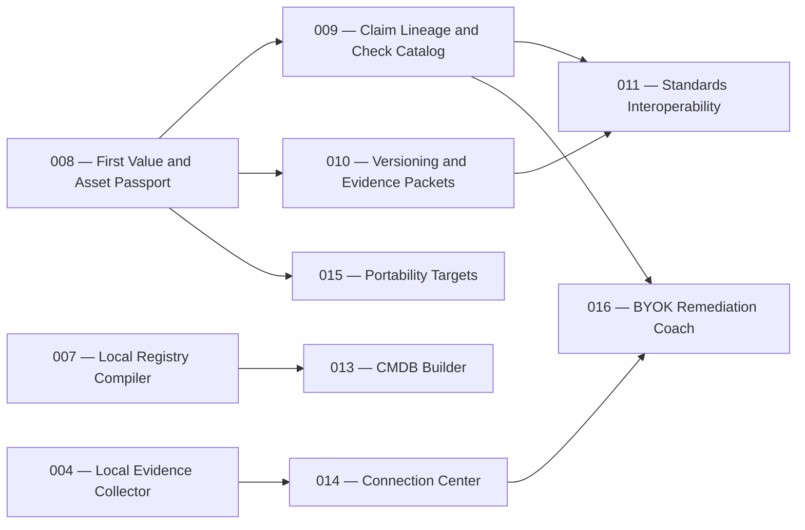

# Product Plan: SancusSight Product Enhancement Roadmap

> Status: Approved
> Approved: 2026-07-23
> Source: `.ai/sdd/handoff/sancussight-product-enhancement-orchestrator-handoff.md` and explicit operator approval relayed from source thread `019f8d31-d1ee-7731-b0fb-b5f7d5beda7c`
> Revised: 2026-07-24 — release-usability features 013–016 added under direct
> operator blanket approval to progress through requirements, design, tasks,
> implementation, and review while preserving normal SDD evidence and gates

## Vision

SancusSight should help an AI power user quickly understand which parts of
their AI setup are portable, controlled, independently usable, and supported
by trustworthy evidence. The enhancement roadmap makes the existing
local-first registry easier to enter, navigate, inspect, compare, and export
without weakening deterministic checks, evidence qualification, privacy, or
human decision authority.

The intended operating loop is:

```text
Asset Passport -> Exit Drill -> Evidence Chain -> Next Action
```

## Steering Context

- Product: `@.ai/steering/product.md`
- Tech stack: `@.ai/steering/tech-stack.md`
- Conventions: `@.ai/steering/conventions.md`
- Principles: N/A — no project `principles.md` exists
- Release recovery: Spec 005 remains a separate paused workstream at
  `implementation:in-progress`; this plan does not authorize T16R5, T16/A-002,
  implementation, deployment, or a release-readiness change

## Personas

- **AI power user / builder:** Needs to inventory AI assets, understand
  dependencies and lock-in, and obtain first value without hand-authoring
  registry JSON.
- **Tool evaluator:** Needs to compare portability and evidence across
  providers without relying on an opaque score.
- **Governance-minded practitioner:** Needs bounded evidence lineage, stable
  check definitions, human decisions, and exportable proof.

## MVP Boundary

### Must Have

- Compiler-backed first-value onboarding alongside clearly distinct sample and
  existing-registry paths.
- A searchable, filterable asset catalog organized around one canonical Asset
  Passport.
- A persistent desktop catalog-plus-passport master-detail experience with a
  deliberate accessible narrow-screen fallback.
- Simplified primary navigation with advanced evidence and governance
  destinations still available.
- A hosted page footer containing only the clickable canonical product URL,
  `https://sancussight.vercel.app`, with no personal name or verbose
  attribution.

### Won't Have Yet

- Aggregate or AI-generated trust scores.
- A default global graph canvas.
- Prompt/response capture, LLM-judge scoring, or cost analytics.
- Automatic migration, upstream enforcement, or policy mutation.
- Hosted accounts, teams, enterprise permissions, or cloud ingestion.
- A plugin marketplace or a DataHub-scale catalog platform.

## Feature Map

### Phase 1 — MVP / Must Have

| ID | Feature | Module | Description |
|---|---|---|---|
| `008` | First Value, Asset Passport, and Navigation | Onboarding, Assets, workspace shell | Distinct onboarding paths, searchable/filterable catalog, canonical Asset Passport, desktop master-detail layout, accessible narrow-screen fallback, selected-row association, simplified navigation, contextual links, and canonical-URL-only hosted footer. |

### Phase 2 — Essentials / Should Have

| ID | Feature | Module | Description |
|---|---|---|---|
| `009` | Claim Lineage and Check Catalog | Evidence, checks, remediation | Bounded typed claim paths, stable check definitions, result history, missing/conflicting/stale evidence states, and direct remediation explanations. |
| `010` | Asset Versioning and Evidence Packets | Assets, comparison, export | Versions, flexible aliases, current-versus-previous comparison, portability regression/recovery history, and sanitized versioned Evidence Packet export. |

### Phase 3 — Nice to Have / Could Have

| ID | Feature | Module | Description |
|---|---|---|---|
| `011` | Standards Interoperability | Import/export adapters | Optional OpenLineage import, OpenTelemetry/OpenInference metadata alignment, optional in-toto-compatible envelope/predicate, and non-enforcing policy-preview research. |

### Phase 4 — Release Usability / Must Have Before Turnkey Claim

| ID | Feature | Module | Description |
|---|---|---|---|
| `013` | CMDB Builder and Canonical Asset Index | Registry compiler, asset metadata | Normalize compiler proposals, retain field-level provenance, and generate a browsable canonical metadata index without silently relocating source assets. |
| `014` | Guided Connection Center | Landing, evidence sources, local companion | Explain hosted versus local operation and guide each evidence producer from prerequisite through artifact validation and connected health. |
| `015` | Scalable Portability Targets | Registry, Asset Passport, Exit Drills | Separate execution surface, provider, model, and protocol; summarize coverage by default and compare a bounded user-selected target set. |
| `016` | BYOK Remediation Coach | Local companion, Attention, plans of action | Use a locally protected provider credential to create evidence-grounded remediation plans with budgets, field-level disclosures, human approval, and no automatic upstream mutation. |

## Dependencies



- Feature 008 establishes the canonical asset identity and interaction model
  used by later lineage, comparison, and packet features.
- Features 009 and 010 may be specified independently after Feature 008's
  product contract is stable.
- Feature 011 depends on the internal claim and packet boundaries being clear
  before external standards are mapped.

## Product Decisions

1. The first approved feature is `008-first-value-asset-passport`.
2. Desktop Assets uses a persistent catalog-plus-Asset-Passport split view;
   the inspector is not placed below the long catalog.
3. Narrow screens use an intentional accessible detail transition with clear
   selected state, focus handling, and return to the catalog.
4. The hosted page footer contains only the clickable canonical URL
   `https://sancussight.vercel.app` and no personal name.
5. Primary navigation is `Home | Assets | Exit Drills | Attention`.
6. Advanced navigation is `Evidence Sources | Governance | Release Proofs |
   Activity | Definitions`.
7. External open-source projects supply product-pattern inspiration, not
   authority to copy code or expand SancusSight's runtime.
8. Release-usability work preserves the local-first boundary: credentials,
   source artifacts, and unrestricted evidence do not enter the hosted app.
9. CMDB standardization extends the compiler proposal pipeline; it does not
   introduce a second scanner or silently move source assets.
10. Portability targets distinguish execution surface, provider, model, and
    protocol rather than treating those concepts as interchangeable columns.
11. BYOK intelligence drafts plans of action; deterministic validation and
    explicit human decisions remain authoritative.

## Risks

| Risk | Impact | Mitigation |
|---|---|---|
| The catalog and passport become another dense governance screen | High | Center Feature 008 on first value, progressive disclosure, one canonical passport, and a stable representative user flow. |
| Responsive behavior hides the selected asset or loses keyboard context | High | Make the narrow-screen transition and focus/return behavior explicit requirements before technical design. |
| New navigation hides advanced release/governance capabilities | Medium | Preserve named advanced destinations and contextual deep links. |
| Hosted output differs from local source | High | Require verification of the deployed canonical URL, not only local development. |
| Pattern adaptation imports platform complexity or license obligations | Medium | Prefer native bounded behavior; record upstream repository, revision, path, license, and NOTICE obligations before any source copying. |
| Enhancement work collides with the large existing dirty worktree | High | Preserve user-owned changes, use orchestrator-owned tracking, and serialize approved implementation tickets by exact writable surface. |

## Open Decisions

- Feature-level decisions belong in each feature's `requirements.md` and later
  approved design. This approved roadmap does not choose responsive
  components, breakpoints, data structures, APIs, or implementation libraries.

## Next Step

Feature 008 is complete at `review:done` and verified on the canonical hosted
URL. Feature 009 requirements, design, and tasks are approved under the
operator's blanket authorization; T1 is its implementation frontier but
is now active in a human-created fresh visible worker because the host creation
API was unavailable. Feature 009 authority remains separate and does not
authorize Spec 005 work or an A-002 run.
