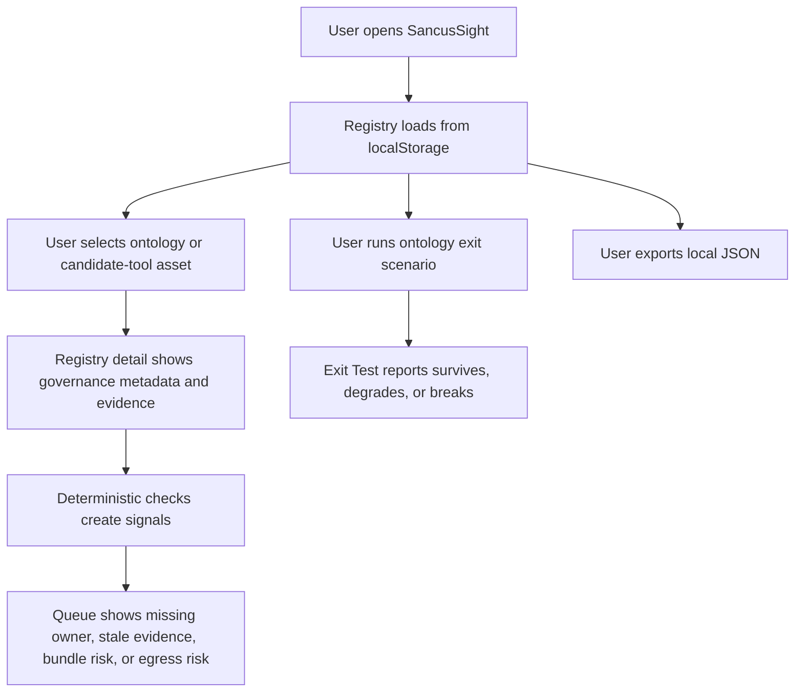
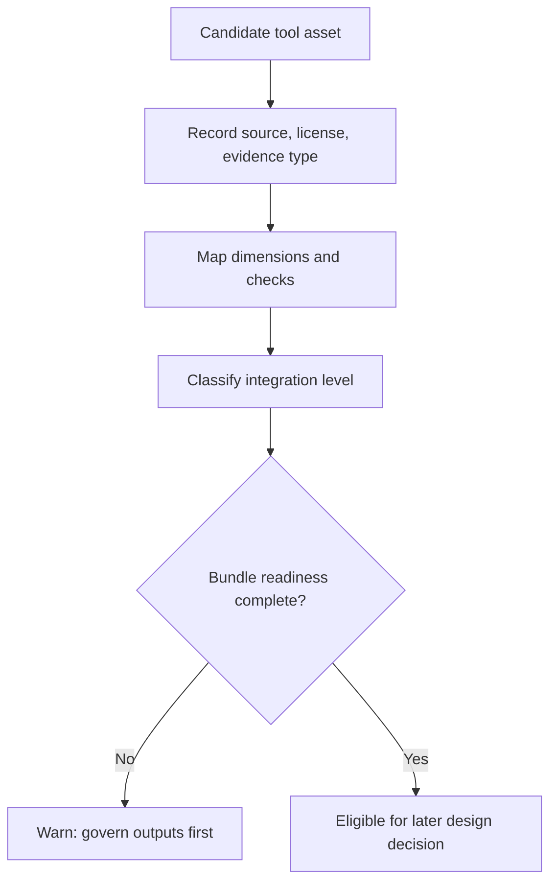

# Design: Personal Ontology Governance

> Requirements: @requirements.md
> Status: Approved

## 1. Summary

Extend SancusSight's existing local registry model so ontology assets, action controls, accepted assets, and candidate open-source trust tools can be represented as first-class governed records. The implementation should stay local-first, deterministic, and metadata-driven: no external runtime calls, no bundled third-party tools, and no hidden authorization behavior.

The first implementation slice should treat Agent Beacon, Praxen, Pipelock, and Kiji Privacy Proxy as candidate evidence/control sources whose outputs are governed by SancusSight. AIMap and RAMPART remain in the broader candidate set but do not need first-slice UI depth beyond being representable.

## 2. Requirements Mapping

| Requirement | Design Coverage |
|-------------|-----------------|
| FR-001 | Extend `AssetKind` and `Asset` metadata with ontology categories and evidence contracts. |
| FR-002 | Add producer/consumer fields and render them in Registry detail. |
| FR-003 | Add `ActionControl` records and deterministic risk signals. |
| FR-004 | Extend exit-test logic with ontology scenarios and compatibility checks. |
| FR-005 | Add accepted-asset metadata: version, license, rationale, provenance, owner, review date. |
| FR-006 | Seed a FindMnemo rename scenario as an exit-test scenario. |
| FR-007 | Keep all checks in `src/lib/*`, import/export via local JSON, and avoid external requests. |
| FR-008 | Add candidate tool records with source URL, license, runtime, egress, maintenance, constraints. |
| FR-009 | Map candidate tools to dimensions and supported checks. |
| FR-010 | Add integration-level classification. |
| FR-011 | Add bundle-readiness fields and warnings without enabling bundling. |
| FR-012 | Add direct-bundle comparison metadata and view copy. |
| NFR-001 | Preserve no-data-leaves-browser behavior; remove or quarantine cloud telemetry behavior if still active. |
| NFR-002 | Every signal names source evidence or missing evidence. |
| NFR-003 | Version local registry exports. |
| NFR-004 | Fit into Registry, Exit Test, Queue, Activity, and Definitions. |
| NFR-005 | Preserve license/source/attribution fields. |
| NFR-006 | Prefer stable evidence contracts over tool-internal coupling. |

## 3. Technical Approach

Use an expand-contract approach inside the existing TypeScript model.

1. Expand `src/types.ts` with new optional fields and small supporting interfaces while keeping existing registry imports valid.
2. Add deterministic evaluators in `src/lib/registry.ts` for ontology records, action controls, accepted assets, and candidate tools.
3. Seed demo data in `src/lib/storage.ts` for the first assessment slice.
4. Render added fields in existing tabs rather than creating a new app mode unless the UI becomes crowded.
5. Update export/import to include a `schemaVersion` while accepting existing unversioned registries.

No third-party security tool is installed, executed, fetched, or bundled in this feature. SancusSight records metadata, source links, evidence descriptions, and import readiness.

## 3a. Research / Prototype Inputs

- Requirements: `.ai/sdd/specs/001-personal-ontology-governance/requirements.md`
- Steering: `.ai/steering/product.md`, `.ai/steering/tech-stack.md`, `.ai/steering/conventions.md`
- Candidate source checks from requirements:
  - AIMap: `https://github.com/BishopFox/aimap`
  - Agent Beacon: `https://github.com/Asymptote-Labs/agent-beacon`
  - Praxen: `https://github.com/open-agent-ai-security/praxen`
  - Pipelock: `https://github.com/luckyPipewrench/pipelock`
  - Kiji Privacy Proxy: `https://github.com/dataiku/kiji-proxy`
  - RAMPART: `https://github.com/microsoft/RAMPART`
- Prototype findings: N/A

## 4. Component / Module Structure

```text
src/
  types.ts
    AssetKind additions
    OntologyCategory
    ActionControl
    CandidateTool
    IntegrationLevel
    EvidenceContract
    BundleReadiness
  lib/
    registry.ts
      dimensionFor additions
      evaluateAsset additions
      evaluateCandidateTool
      evaluateActionControl
      runOntologyExitScenario
    storage.ts
      DEMO_REGISTRY additions
      schemaVersion import/export support
  components/
    Registry.tsx
      detail sections for ontology, controls, candidate tools
    ExitTest.tsx
      ontology scenario selector or scenario block
    Queue.tsx
      uses existing flagged signals
    Definitions.tsx
      glossary additions
    ActivityLog.tsx
      optional import guidance only, no external sync
    Header.tsx / App.tsx
      remove or isolate cloud telemetry actions if they violate local-only constraints
```

## 5. Data Model / State

Extend the existing `Asset` interface with optional fields so existing records remain valid.

```ts
type AssetKind =
  | 'context'
  | 'skill'
  | 'prompt-template'
  | 'intent-context'
  | 'workflow'
  | 'control'
  | 'evaluation'
  | 'ontology-object'
  | 'ontology-link'
  | 'ontology-action'
  | 'schema'
  | 'evidence-contract'
  | 'consumer-adapter'
  | 'candidate-tool'
  | 'accepted-asset'

type ActionAuthority =
  | 'read-only'
  | 'propose-only'
  | 'user-confirmed-write'
  | 'automated-write'

type IntegrationLevel =
  | 'reference-only'
  | 'manual-import'
  | 'local-adapter'
  | 'bundled-dependency'
  | 'replacement-candidate'
```

Optional `Asset` fields:

```ts
interface Asset {
  // existing fields remain
  sourceProduct?: string
  producingProduct?: string
  consumingProducts?: string[]
  supportedVersion?: string
  stableId?: string
  ontologyCategory?: 'object' | 'link' | 'action' | 'schema' | 'evidence-contract' | 'adapter'
  actionControl?: ActionControl
  acceptedAsset?: AcceptedAssetMetadata
  candidateTool?: CandidateTool
}
```

Supporting interfaces:

```ts
interface ActionControl {
  authority: ActionAuthority
  requiredControls: string[]
  confirmation: string
  reversible: boolean
  evidenceNeeds: string[]
}

interface AcceptedAssetMetadata {
  version?: string
  license?: string
  ownershipEvidence?: string
  decisionRationale: string
  sourceProvenance: string
  scope: string
}

interface CandidateTool {
  sourceUrl: string
  license: string
  evidenceType: string
  runtimeRequirements: string[]
  dataEgress: 'none-known' | 'local-only' | 'network-required' | 'unknown'
  trustBoundary: string
  maintenanceStatus: string
  knownUseConstraints: string[]
  dimensions: Dimension[]
  supportedChecks: string[]
  integrationLevel: IntegrationLevel
  bundleReadiness?: BundleReadiness
  directBundleTradeoff?: string
}

interface BundleReadiness {
  licenseReviewed: boolean
  attributionRecorded: boolean
  trademarkReviewed: boolean
  updatePlanRecorded: boolean
  securityModelReviewed: boolean
  dataFlowReviewed: boolean
  rollbackPlanRecorded: boolean
}
```

`Registry` should gain `schemaVersion?: 2`. Import logic accepts missing versions as v1 and preserves unknown asset fields where practical.

## 6. API / Integration Contract

No backend API is added. The integration contract is local JSON import/export.

Import/export rules:

- Export includes `schemaVersion: 2`, `platforms`, `updatedAt`, and `assets`.
- Import accepts v1 registries without ontology fields.
- Import validates only the minimum shape needed to avoid app crashes: `assets` array and `platforms` string array.
- Candidate-tool records are metadata only; SancusSight does not fetch GitHub data at runtime.
- Future local adapters can be designed later as explicit import schemas, not as tool execution.

## 7. Security / Permissions / Privacy

- SancusSight must not execute AIMap, Agent Beacon, Praxen, Pipelock, Kiji Privacy Proxy, RAMPART, or any external CLI in the browser.
- SancusSight must not request API keys or secrets for ontology governance.
- Active security testing must be represented only as metadata unless a later approved design adds authorized local execution outside the browser.
- Candidate tools with `dataEgress = 'network-required'` or `unknown` produce warning signals until reviewed.
- `bundled-dependency` integration level is allowed as a recorded classification but should produce a warning unless bundle readiness is complete.
- Current Supabase telemetry loading appears to conflict with the no-external-requests runtime constraint. The implementation should remove it, hide it behind an explicit out-of-scope flag, or replace it with local JSON import as part of standards cleanup.

## 8. User Flows



Candidate tool assessment flow:



## 9. Edge Cases

| Case | Expected Behavior |
|------|-------------------|
| Imported v1 registry | Load successfully; missing ontology fields are treated as absent. |
| Candidate tool has no license | Evidence signal fails or warns and action asks for license review. |
| Candidate tool has unknown data egress | Controls signal warns and asks for data-flow review. |
| Action authority is automated write | Controls signal fails unless required controls, reversibility, and evidence needs are recorded. |
| Bundle integration selected without readiness | Signal warns that bundling is not design-approved. |
| FindMnemo legacy identifier appears | Exit scenario distinguishes stable ID compatibility from product display name. |
| No candidate tools present | UI remains usable; no empty-state crash. |
| Existing assets use unknown kind | Import should not crash; unknown kind maps to evidence or unknown signal handling. |

## 10. Accessibility / UX Notes

- Keep color paired with text labels in coverage, queue, and exit-test status.
- Candidate tool fields should appear in compact detail sections with labels, not dense prose.
- Use existing tabs first. The product should not add a new top-level tab unless implementation shows the Registry detail becomes too crowded.
- Button copy should describe concrete actions such as "Record review today" or "Export registry"; avoid explaining the product inside the UI.
- Long source URLs should wrap or truncate without breaking the detail layout.

## 11. Observability / Operations

No remote observability is added. The operational evidence is local:

- deterministic `Signal` records in memory;
- localStorage registry state;
- exported JSON;
- generated share card markdown.

If cloud telemetry is removed or disabled, document that as a standards cleanup because local-first behavior is a product constraint.

## 12. Migration / Rollout

Migration is additive:

1. Add optional fields and v2 demo data.
2. Keep import compatibility with v1 data.
3. Add UI rendering for optional metadata.
4. Extend checks.
5. Run `npm run build`.

Rollback is straightforward: exported v2 JSON remains local; the app can ignore unknown fields if the UI is reverted.

## 13. Technical Decisions

### TD-001: Extend `Asset` instead of adding a parallel registry

- **Decision:** Ontology assets, candidate tools, action controls, and accepted assets remain assets with optional typed metadata.
- **Why:** The current product value is a unified registry and coverage matrix.
- **Trade-off:** `Asset` becomes broader, so field names must stay disciplined.
- **Alternatives considered:** Separate `ontologyAssets` and `candidateTools` arrays; rejected because it would fragment checks and UI.

### TD-002: Govern outputs before executing tools

- **Decision:** Candidate tools are metadata and evidence sources only in this feature.
- **Why:** This matches approved requirements and avoids bundling, installer, and legal obligations.
- **Trade-off:** Users do not get one-click tool execution.
- **Alternatives considered:** Browser-based execution or bundled CLIs; rejected as out of scope.

### TD-003: Deterministic checks stay in pure functions

- **Decision:** Extend `evaluateAsset`, `runExitTest`, and related helpers rather than adding AI scoring.
- **Why:** Existing steering requires deterministic checks on metadata.
- **Trade-off:** Some nuanced trust judgments remain manual.
- **Alternatives considered:** Weighted scorecards; rejected because they can hide evidence gaps.

### TD-004: Remove or quarantine runtime Supabase telemetry loading

- **Decision:** The approved design favors local JSON import/export over runtime cloud telemetry loading.
- **Why:** Steering says no external requests at runtime and no data leaves the browser.
- **Trade-off:** Less automatic data discovery.
- **Alternatives considered:** Keeping Supabase as optional; only acceptable if explicitly out of the runtime path and not exposed as normal SancusSight behavior.

## 14. Risks

| Risk | Impact | Mitigation |
|------|--------|------------|
| Asset model gets too broad | Medium | Keep optional fields grouped under `candidateTool`, `actionControl`, and `acceptedAsset`. |
| Candidate tool claims go stale | Medium | Require review dates, source URLs, and maintenance status signals. |
| User mistakes metadata for security assurance | High | UI and generated share card must state checks are metadata evidence, not a security assessment. |
| Bundling pressure creeps in | Medium | Keep bundle readiness as a warning/check, not an implementation path. |
| Existing cloud telemetry conflicts with local-first promise | High | Remove/quarantine it during implementation if it is active in the UI. |

## 15. Verification Strategy

- Unit/component: no test framework is configured. If adding Vitest is not part of the tasks, use TypeScript build and manual checks.
- Integration/API: N/A, no backend integration.
- E2E/manual:
  - Load app.
  - Confirm Registry shows ontology/candidate-tool assets.
  - Select each first-slice candidate tool and verify source/license/dimensions/integration fields are visible.
  - Confirm Queue includes warnings for missing evidence, unknown egress, or incomplete bundle readiness.
  - Run Exit Test and confirm ontology/FindMnemo compatibility scenario is represented.
  - Export and re-import registry JSON.
- Build/lint/typecheck:
  - `npm run build`
- Preferred test seam:
  - Pure functions in `src/lib/registry.ts` and import/export in `src/lib/storage.ts`.
- Red/green starting test:
  - If Vitest is added, start with `evaluateCandidateTool` producing a warning for `bundled-dependency` without complete bundle readiness.

## 16. Implementation FAQ

**Q:** Should SancusSight install or run any of the candidate tools?  
**A:** No. This design governs outputs and metadata only.

**Q:** Should a candidate tool be represented as `control` or `candidate-tool`?  
**A:** Use `candidate-tool` when evaluating the tool itself. Use `control` for an adopted control record that may cite the candidate tool as evidence.

**Q:** Should AIMap and RAMPART be omitted from the model because they are not first-slice tools?  
**A:** No. The data model must represent all six, but the UI depth and seeded first-slice detail can prioritize Agent Beacon, Praxen, Pipelock, and Kiji Privacy Proxy.

**Q:** Can implementation add a new top-level tab?  
**A:** Only if the existing Registry and Definitions views become materially overloaded. The default is to extend existing views.

**Q:** Can implementation change approved requirements?  
**A:** No. If the local-first or no-bundling constraints need to change, return to requirements/design approval first.
