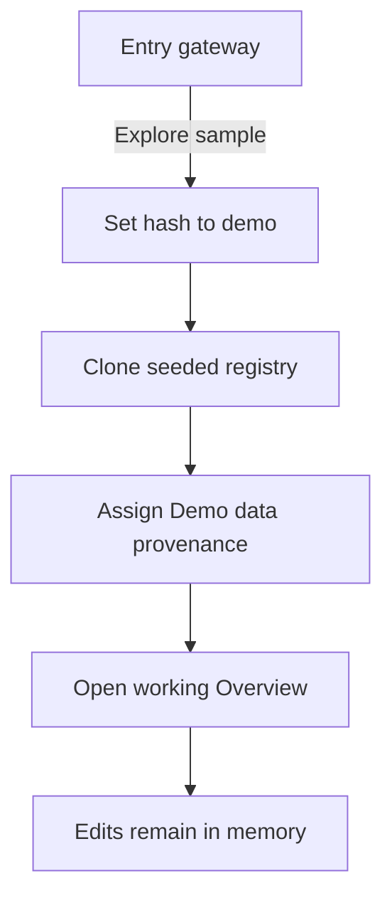
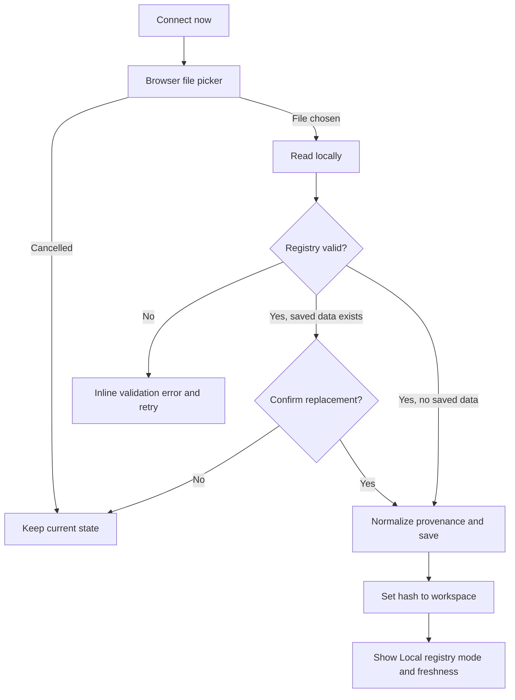

# Design: Landing Gateway and UI Hierarchy

> Requirements: @requirements.md
> Status: Approved

## 1. Summary

Add a truthful entry gateway before the existing SancusSight workspace. The default route presents the product, an actual bundled workspace image, and two first-viewport commands: `Explore sample` and `Connect now`. The sample route opens an in-memory demo registry; the connection route validates a local JSON registry before replacing saved local state. Neither route adds an account, backend, live connector, or external runtime request.

Inside the workspace, make provenance persistent and simplify the operating hierarchy. Overview findings become asset-level groups, core navigation receives priority, candidate-tool assessments use progressive disclosure, and destructive data actions require confirmation. Existing deterministic checks, signal semantics, ontology records, and the unified coverage matrix remain intact.

## 2. Requirements Mapping

| Requirement | Design coverage |
|---|---|
| FR-001 | `LandingGateway` is the default route and keeps both approved commands in the first viewport. |
| FR-002 | `RegistryProvenance`, workspace mode labels, export metadata, and share-card headings preserve demo identity. |
| FR-003 | A browser File API connection flow uses the existing compatible registry parser before activation. |
| FR-004 | `WorkspaceHeader` displays `Demo data` or `Local registry` plus source freshness. |
| FR-005 | Demo state is isolated from saved local state; replacement and reset/clear actions use confirmation. |
| FR-006 | A pure asset-grouping helper supplies worst status, count, and underlying signals. |
| FR-007 | Overview renders at most six grouped assets and links to the complete Queue. |
| FR-008 | Dimension cards render only non-zero status categories and do not calculate a score. |
| FR-009 | `CandidateToolDetail` separates decision-critical facts from expandable supporting evidence. |
| FR-010 | Core tabs remain visible; Definitions and Activity move to secondary navigation. |
| FR-011 | A contextual notice region reports connection success, cancellation, validation failure, and recovery. |
| FR-012 | The coverage legend defines verified, stale, unverified, not shared, `PRI`, `FBK`, and not applicable. |
| NFR-001 | All import, storage, evaluation, export, and imagery remain local to the browser/static bundle. |
| NFR-002 | Native controls, visible focus, textual status labels, and a 0.72rem minimum support accessibility. |
| NFR-003 | Stable navigation, bounded layouts, local matrix scrolling, and responsive queue/detail views cover 390px and desktop. |
| NFR-004 | Revised neutral surfaces, preserved thermal status colors, and a real product screenshot retain the audit-ledger identity. |
| NFR-005 | The static Vite architecture and existing deterministic evaluation functions remain the runtime boundary. |

## 3. Architecture

Use the existing React/Vite single-page application without adding a router or state library.

```text
App
  route parser + hashchange listener
  landing connection state
  active registry session
  |
  +-- LandingGateway
  |     bundled workspace image
  |     Explore sample -> #demo
  |     Connect now -> local file validation
  |
  +-- WorkspaceShell
        WorkspaceHeader
        WorkspaceNavigation
        ContextNotice
        existing product views
```

Supported hash routes:

| Hash | Result |
|---|---|
| empty or `#landing` | Entry gateway |
| `#demo` | Workspace with a fresh in-memory clone of the demo registry |
| `#workspace` | Workspace with the validated saved local registry |
| unknown hash | Entry gateway with no destructive state change |

`App` owns route, active registry, data mode, selected workspace view, selected asset, and notices. A single route parser is used at startup and on `hashchange`, allowing normal browser back/forward behavior. Direct navigation to `#workspace` without valid saved data returns to the gateway with an inline recovery message.

## 4. Component and Module Changes

```text
src/
  App.tsx
    route/session orchestration
    mode-aware registry updates
  types.ts
    DataMode, RegistryProvenance, ConnectionNotice, grouped finding type
    primary and secondary navigation definitions
  lib/
    storage.ts
      loadLocalRegistry, saveLocalRegistry, clearLocalRegistry
      createDemoRegistry, importJSON, exportJSON
    registry.ts
      groupFlaggedByAsset
      provenance-aware share card generation
    route.ts
      parseAppRoute and route constants
  components/
    LandingGateway.tsx
    WorkspaceShell.tsx
    Header.tsx
      mode/freshness and contextual data actions
    WorkspaceNavigation.tsx
      primary tabs and secondary menu
    ConnectionNotice.tsx
    Overview.tsx
      grouped findings and non-zero dimension counts
    Registry.tsx
      complete legend and progressive candidate detail
    Queue.tsx
      desktop table and narrow-screen list presentation
    ExitTest.tsx
      responsive item layout and restrained risk labels
    ShareCard.tsx
      visible data-mode context
public/
  sancussight-workspace.webp
    local screenshot of the synthetic SancusSight workspace
```

Small components may remain in existing files where extraction would add no clarity. `WorkspaceShell` is the intended ownership boundary between entry routing and the existing operating views.

## 5. Data Model and State

Add explicit provenance to the additive v2 registry shape:

```ts
export type DataMode = 'demo' | 'local'

export interface RegistryProvenance {
  mode: DataMode
  connectedAt?: string
  sourceUpdatedAt: string
}

export interface Registry {
  schemaVersion: 2
  platforms: Platform[]
  updatedAt: string
  assets: Asset[]
  provenance?: RegistryProvenance
}
```

`provenance` remains optional at the type boundary so current v2 and compatible unversioned files can be imported. Normalization assigns missing provenance as local only after validation. The source file's `updatedAt` becomes `sourceUpdatedAt`; `connectedAt` records when it entered this browser. A file explicitly marked as demo remains demo after import and in any subsequent export or share artifact.

Runtime state is explicit:

```ts
interface RegistrySession {
  registry: Registry
  mode: DataMode
}
```

Storage rules:

1. `loadLocalRegistry()` returns `Registry | undefined`; it never substitutes demo data.
2. `createDemoRegistry()` deep-clones the seeded registry and assigns demo provenance.
3. Demo edits update React state only and never call `saveLocalRegistry()`.
4. Local edits update React state and save a normalized local registry.
5. Valid local replacement is committed only after any required confirmation.
6. Invalid input, file-picker cancellation, or cancelled confirmation leaves both active and saved state unchanged.
7. `clearLocalRegistry()` removes only saved local data. It does not relabel demo data or silently open a replacement registry.

This removes the current ambiguity in which `loadRegistry()` returns demo data when no valid saved registry exists.

## 6. Entry Gateway Design

The gateway is the real product entrance, not a separate marketing site.

- The hero occupies approximately 78-82svh so the next trust strip remains visible.
- `SancusSight` is the H1 and strongest first-viewport signal.
- Supporting copy states the literal outcome: see what the AI environment depends on, what is portable, and what needs attention.
- `Explore sample` is a link to `#demo` and is labeled as synthetic demonstration data.
- `Connect now` is a button that opens a hidden JSON file input and states that data remains in the browser with no account.
- The background uses a locally bundled screenshot captured from SancusSight's synthetic workspace. A flat solid-color scrim may protect text contrast; gradients and abstract decoration are excluded.
- A full-width trust strip below the hero presents three concise properties: local-only, deterministic checks, and exportable evidence. It is not rendered as cards.
- Connection success, cancellation, and errors appear adjacent to the Connect command and remain keyboard discoverable through an `aria-live="polite"` notice. The file input's native cancellation event is used, with focus-return detection as a fallback where needed.

The screenshot contains demo data only, receives useful alt text when exposed as content, and has a CSS background-color fallback if the image does not load.

## 7. Connection and Route Flows

### Explore sample



### Connect actual data



If an imported artifact explicitly carries demo provenance, it opens as `Demo data` and is not saved as actual local evidence. The success notice explains that provenance was preserved.

### Workspace data actions

- Demo mode primary action: `Connect now`.
- Local mode primary action: `Export registry`.
- Share, replace data, return to entry, and reset/clear are secondary utilities.
- Replacing connected data and clearing saved local data require confirmation.
- Resetting a demo session to its seed also requires confirmation because in-memory edits may be lost.
- Native `window.confirm` is acceptable for this bounded implementation; browser alerts are not used for status or validation feedback.

## 8. Workspace Information Hierarchy

Primary navigation remains continuously available in this order:

1. Overview
2. Registry
3. Exit Test
4. Queue

Definitions and Activity move to a labeled secondary menu. On narrow screens, the primary destinations stay in one horizontally scrollable, single-line navigation region with stable item dimensions; they do not wrap into multiple rows. The secondary menu is keyboard-operable and closes on selection, Escape, or focus leaving the menu.

The header displays:

- SancusSight wordmark/home action.
- Persistent `Demo data` or `Local registry` badge.
- Freshness using `sourceUpdatedAt`, with connected time available for local data.
- Asset and platform counts as secondary metadata.
- One mode-appropriate primary data action and a restrained utility menu.

## 9. Overview and Queue

Add a pure helper:

```ts
interface AssetFindingGroup {
  assetId: string
  assetName: string
  worstStatus: SignalStatus
  findingCount: number
  signals: Signal[]
}

groupFlaggedByAsset(signals: Signal[]): AssetFindingGroup[]
```

The helper excludes passing signals, groups by `assetId`, and sorts by worst status using the existing deterministic priority (`fail`, `warn`, `unknown`, `accepted`) and then asset name. Overview renders the first six groups. Each row shows worst textual status, asset name, finding count, one concise lead finding, and a command that opens the asset detail with all underlying signals. A link opens the complete Queue.

Dimension cards retain current rollups but render only status categories whose count is greater than zero. A restrained proportional status strip may use the existing counts, provided every segment has a textual counterpart and no aggregate score or implied grade is introduced.

Queue remains the complete signal-level record rather than repeating Overview's grouped abstraction. Desktop keeps the evidence table. Below the narrow-screen breakpoint, the same fields reflow into vertically stacked rows so the page does not depend on a 48rem table or page-level horizontal scrolling.

## 10. Registry and Candidate Assessment

The coverage matrix remains the primary registry surface and may scroll within its own bounded container. Its legend becomes complete:

`verified`, `stale`, `unverified`, `not shared`, `PRI - primary provider`, `FBK - fallback provider`, and `dot - not applicable`.

Selecting an asset retains the existing direct link from Overview and Queue. On desktop, the detail follows the matrix in the document flow with a clear selected-row state; on narrow screens, all detail grids collapse to one column and long URLs wrap. This avoids introducing a modal or drawer that would make evidence comparison and keyboard flow more fragile.

Candidate-tool detail uses three levels:

1. **Assessment summary:** explicitly labeled assessment depth, integration relationship, and disposition.
2. **Decision-critical facts:** license, data egress, integration relationship, disposition rationale, evidence output, and recorded/missing evidence. Unknown and network-required egress use caution styling paired with text.
3. **Supporting evidence:** native `<details>` groups for runtime and trust boundary; attribution, constraints, and trade-off; and bundle-readiness checks.

Facts, human decisions, missing evidence, and readiness checks receive distinct section labels and restrained borders/backgrounds. Accepted disposition never suppresses an egress warning. Native disclosure elements keep keyboard and screen-reader behavior without a new UI dependency.

## 11. Visual System

Preserve the current navy, moss, amber, rust, slate, serif headline, and monospace evidence language while shifting the base surfaces away from cream dominance.

- Page neutral: cool off-white/light gray.
- Working surfaces: white and a slightly stronger neutral.
- Cards: maximum 6px radius, subtle border, minimal shadow.
- Typography: letter spacing is zero; compact labels rely on weight, case, and spacing rather than tracking.
- Operational text: at least 0.72rem; body text generally 0.8rem or larger.
- Focus: visible 2px outline with offset on buttons, links, tabs, file controls, and disclosures.
- Motion: optional 100-150ms color/border transitions only; reduced-motion preference is respected.
- Status: color is always paired with a word or established glyph plus legend.

No gradient, decorative chart, abstract security illustration, nested card, oversized dashboard heading, or new icon package is introduced.

## 12. Security, Privacy, and Failure Handling

- File content is read with the browser File API and never uploaded or fetched.
- The landing image is part of the static application bundle.
- Existing minimum import shape validation remains and is extended only for provenance normalization.
- Errors identify the invalid registry shape and a retry action without exposing local paths.
- Object URLs created for export are revoked after use.
- No candidate tool is installed, executed, or contacted by this feature.
- All deterministic checks continue to operate on the active registry in memory.

## 13. Edge Cases

| Case | Expected behavior |
|---|---|
| No saved local registry | Default route shows the gateway; direct `#workspace` returns there with recovery text. |
| Existing local registry plus demo route | Demo opens independently; saved local data remains unchanged. |
| File picker cancelled | No route, active registry, or saved data is changed; a neutral cancellation notice is shown with a retry action. |
| Invalid JSON or invalid shape | Inline error appears and the current registry remains untouched. |
| Valid replacement cancelled | Existing local state and route remain unchanged. |
| Imported compatible unversioned registry | Normalize as v2 local data and preserve its source freshness when available. |
| Imported demo-marked registry | Keep `Demo data` mode and do not relabel it as local evidence. |
| Demo export or share card | Include a prominent demo marker in the title and provenance text. |
| Zero affected assets | Show factual empty-state copy without suspicion or alarm. |
| More than six affected assets | Overview shows six; Queue exposes every underlying signal. |
| Asset has several findings | Overview groups them; Registry detail and Queue retain each signal. |
| Candidate tool has unknown egress but accepted disposition | Caution remains visible in the summary. |
| Candidate tool has no supporting metadata | Omit empty disclosure groups without crashing. |
| Back/forward across hashes | Route and active data source are reconstructed from the single parser. |
| Mobile 390px layout | Hero commands fit, nav stays single-line, detail/queue reflow, matrix scroll is local. |

## 14. Technical Decisions

### TD-001: Use hash routing without a router dependency

- **Decision:** Use empty/`#landing`, `#demo`, and `#workspace` routes with one parser and `hashchange` listener.
- **Why:** The app has three simple entry states and must remain a small static bundle.
- **Trade-off:** Workspace subviews are not deep-linked in this slice.
- **Alternative:** Add React Router; rejected because the dependency and route surface are not justified.

### TD-002: Isolate demo state from saved local state

- **Decision:** Demo uses an in-memory clone; only local sessions write to localStorage.
- **Why:** Sample exploration must never overwrite or masquerade as actual evidence.
- **Trade-off:** Demo edits disappear when the demo session is restarted unless exported.
- **Alternative:** Continue using demo as a storage fallback; rejected because provenance cannot be trusted.

### TD-003: Make provenance an additive registry field

- **Decision:** Add optional v2 provenance and normalize legacy imports after validation.
- **Why:** Workspace, exports, and share cards need one consistent source of truth.
- **Trade-off:** Older clients ignore the additive field.
- **Alternative:** Keep provenance only in React state; rejected because exported artifacts would lose it.

### TD-004: Use a bundled screenshot of the actual product

- **Decision:** Capture a synthetic SancusSight workspace state and commit it as a local WebP asset.
- **Why:** The entry page should show the product without network requests or abstract security imagery.
- **Trade-off:** The screenshot must be refreshed when the workspace changes materially.
- **Alternative:** Build a decorative illustration; rejected by the approved visual boundary.

### TD-005: Group only the Overview abstraction

- **Decision:** Overview groups by asset while Queue and Registry retain signal-level evidence.
- **Why:** Prioritization becomes calmer without reducing auditability.
- **Trade-off:** Overview and Queue intentionally use different levels of detail.

### TD-006: Use native progressive disclosure and confirmations

- **Decision:** Use `<details>` and `window.confirm` for this bounded static feature.
- **Why:** They provide accessible baseline behavior without a component dependency.
- **Trade-off:** Confirmation styling remains browser-native.

### TD-007: Do not add a test framework in this feature

- **Decision:** Verify pure helper behavior with dependency-free assertions, run the TypeScript/Vite build, and perform browser flow checks.
- **Why:** No test framework is configured and this design does not need a new project-wide testing decision.
- **Trade-off:** Component behavior is verified through browser checks rather than unit component tests.

## 15. Risks and Mitigations

| Risk | Impact | Mitigation |
|---|---|---|
| Gateway delays returning users | Medium | Hash routes support direct workspace access; the gateway remains short and command-focused. |
| Demo and local state drift | High | One session model, explicit mode badge, provenance in artifacts, and separate storage functions. |
| Local data is replaced accidentally | High | Validate first, confirm replacement, and commit only after confirmation. |
| Product screenshot becomes stale | Low | Capture from synthetic data during implementation and verify it with the final UI. |
| Progressive detail hides important risk | Medium | Egress and disposition remain in the always-visible summary; only supporting fields collapse. |
| Navigation becomes crowded on mobile | Medium | Four fixed primary destinations in one non-wrapping region; references move to a secondary menu. |
| Visual polish weakens audit credibility | Medium | Preserve evidence density, thermal status colors, low-radius surfaces, and no-score policy. |

## 16. Verification Strategy

### Pure logic checks

- `loadLocalRegistry()` returns undefined rather than demo when storage is empty or invalid.
- `createDemoRegistry()` returns a clone with demo provenance.
- Demo updates do not invoke local persistence.
- Import normalization preserves explicit demo provenance and assigns local provenance to compatible legacy files.
- Failed or cancelled replacement preserves the prior local registry.
- `groupFlaggedByAsset()` returns deterministic worst status, counts, underlying signals, and stable ordering.
- Share markdown and JSON export contain the correct mode marker.

The first red/green seam should prove that creating and editing a demo session leaves an existing saved local registry byte-for-byte unchanged.

### Build and static verification

- Run `npm run build`.
- Confirm no new runtime network dependency or request is introduced.
- Confirm the local image is included in the production bundle.

### Browser verification

Use desktop 1280x720 and mobile 390x844 viewports:

1. Open `/` and verify the brand, product image, and both commands are visible without overlap.
2. Open the sample and verify the persistent `Demo data` marker, grouped Overview, bounded six-item list, and non-zero counts.
3. Export and open the share card; verify both identify demo provenance.
4. Return to entry and test `Connect now` with valid, invalid, and cancelled file selection.
5. Verify valid local data opens with `Local registry` and source freshness.
6. Verify demo exploration did not overwrite the saved local registry.
7. Verify replacement and reset cancellation preserve current state.
8. Verify back/forward route behavior, primary/secondary navigation, and visible focus.
9. Verify candidate summaries, cautionary egress, disclosure keyboard behavior, and complete coverage legend.
10. Verify Queue and detail reflow without page-level horizontal overflow; matrix scrolling remains bounded.
11. Verify the console is clean and no external runtime requests occur.

Capture final desktop and mobile screenshots after these checks.

## 17. Implementation FAQ

**Does `Connect now` call a cloud service or ask for credentials?**  
No. It opens a local JSON file picker, validates in the browser, and stores compatible data locally.

**Can demo exploration overwrite a previously connected registry?**  
No. Demo state is an in-memory clone and persistence is disabled in demo mode.

**Should a demo-marked export become local data when re-imported?**  
No. Explicit demo provenance is preserved so synthetic evidence is never relabeled as actual.

**Where does the landing visual come from?**  
A committed screenshot of SancusSight running with synthetic demo data. It is not fetched at runtime.

**Should implementation add a routing, icon, modal, or chart library?**  
No. Native browser and existing React/Tailwind capabilities are sufficient for the approved scope.

**Does the Queue also group findings by asset?**  
No. Overview is the prioritization abstraction; Queue remains the complete signal-level record.

**Can implementation change deterministic checks or candidate-tool semantics?**  
No. Any required contract change returns to requirements/design approval.
