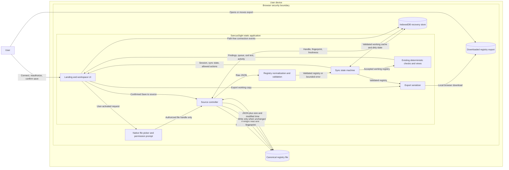
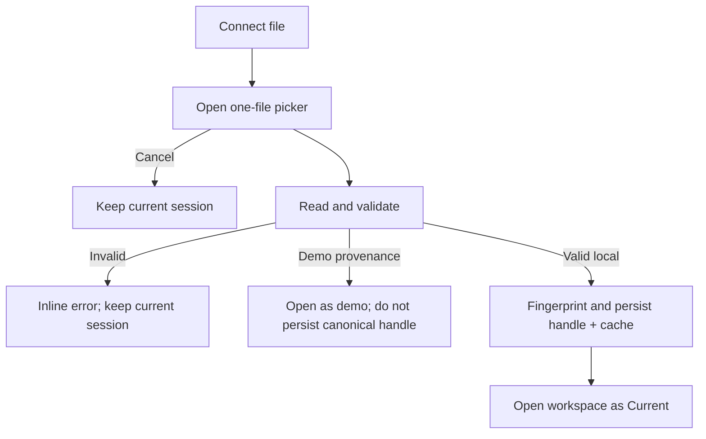

# Design: Persistent Local File Connector

> Requirements: @requirements.md
> Status: Approved

## 1. Summary

Replace the current one-time JSON import as the preferred `Connect now` behavior with a progressive local-file connector. In supported browsers, the user chooses one registry file whose `FileSystemFileHandle` is retained in IndexedDB. That file is canonical; a validated browser-local working copy is only a recovery cache. SancusSight checks the source on restore, manual refresh, and a coalesced focus check, and it never writes without a user-confirmed `Save to source` action.

The implementation remains a static React/Vite application with no backend or runtime network access. Browsers without the File System Access API retain the current input-based import/export workflow, explicitly labeled `Snapshot`. External and local concurrent changes produce a blocking conflict instead of an automatic merge.

## 2. Research Inputs

The design relies on the current File System Access API constraints:

- The [WICG File System Access specification](https://wicg.github.io/file-system-access/) defines file handles as secure-context, serializable objects with `queryPermission()` and user-activated `requestPermission()` behavior. A handle restored from IndexedDB can return `prompt` even when it was previously granted.
- [Chrome's File System Access guidance](https://developer.chrome.com/docs/capabilities/web-apis/file-system-access) documents user-activated file pickers, `getFile()`, `createWritable()`, IndexedDB handle persistence, feature detection, and the input/download fallback limitations.

Consequences:

1. SancusSight can remember a handle but cannot promise durable permission.
2. Startup may query permission but must reserve permission requests for a user action.
3. Full paths are neither needed nor exposed; only the handle's safe display name is used.
4. Persistent connection is progressive enhancement, not a cross-browser guarantee.

## 3. Requirements Mapping

| Requirement | Design coverage |
|---|---|
| FR-001 | `BrowserFileConnector.pickSource()` selects one JSON file and `connection-store.ts` persists its handle. |
| FR-002 | Capability detection switches unsupported browsers to the existing input-based snapshot import/export flow. |
| FR-003 | `SourceStatus` displays safe filename, last successful read, permission, and one synchronization state. |
| FR-004 | Manual refresh and coalesced focus checks use one source-check operation and validate before activation. |
| FR-005 | Registry edits update the IndexedDB cache and transition to `Unsaved changes` without source writes. |
| FR-006 | The pure source state machine enters `Conflict` when both accepted source and working copy diverge. |
| FR-007 | Save shows a write summary, requests write permission when needed, performs a fresh preflight read, then writes. |
| FR-008 | Cache-first hydration, cached labeling, reauthorization, replacement, export, and disconnect preserve recovery. |
| FR-009 | Confirmed disconnect removes browser connection/cache records and never calls a file write/delete operation. |
| FR-010 | The accepted working registry continues through existing normalization and deterministic checks. |
| FR-011 | Connection events are retained locally in the connector database without paths or file content. |
| NFR-001 | Browser-only APIs, least-privilege prompts, safe names, and no runtime requests preserve privacy. |
| NFR-002 | Validation-before-activation, source fingerprints, preflight reads, and dirty-cache retention protect integrity. |
| NFR-003 | Native controls, textual states, inline recovery, and explicit commands support accessible operation. |
| NFR-004 | Cache-first restore, metadata prechecks, and coalesced focus checks bound routine work. |
| NFR-005 | The static build remains unchanged and unsupported browsers expose snapshot semantics. |

## 4. Architecture

Keep `App` as the route and session owner. Isolate browser file APIs and IndexedDB from React so connector behavior can be tested with a fake adapter.

```text
App
  route/session orchestration
  hydration + focus-check coordinator
  |
  +-- LandingGateway
  |     Explore sample
  |     Connect file -> persistent connector when supported
  |     Import snapshot -> fallback when unsupported
  |
  +-- WorkspaceShell
        Header
          SourceStatus
          Refresh / Save / connection menu
        ConnectionNotice
        ConflictPanel
        existing deterministic workspace views

source-controller (workflow orchestration)
  +-- source-state (pure transitions)
  +-- FileConnectorAdapter
  |     BrowserFileConnector (production)
  |     FakeFileConnector (verification)
  +-- connection-store (IndexedDB handle/cache/activity)
  +-- existing session normalization
```

The controller returns explicit results rather than mutating UI state. `App` commits a returned session and notice as one React update. A single in-flight operation guard prevents Strict Mode hydration, focus, and manual refresh from overlapping.

### 4.1 Data Flow Diagram



Data ownership and trust rules:

| Data | Authority | Stored where | Permitted flow |
|---|---|---|---|
| Registry evidence | Canonical local file when connected | User filesystem | Read through authorized handle; confirmed conflict-free write only |
| Working registry | Recovery copy, never independent authority | IndexedDB and React state | Existing deterministic checks, views, and explicit export |
| File handle | Browser-granted capability | IndexedDB | Source controller only; never serialized into registry artifacts |
| Fingerprint and freshness | Connector consistency metadata | IndexedDB | Source controller and source-status UI |
| Connection activity | Local audit evidence | IndexedDB | Activity view; safe filename only |
| Export | User-created portable snapshot | Browser download destination | Explicit user action only |

There is deliberately no server, cloud store, analytics endpoint, candidate-tool runtime, or arbitrary filesystem path flow. The browser mediates every source read and write through the authorized handle.

## 5. Data Model

Registry provenance remains compatible with the approved v2 artifact. Connection authority is browser-local metadata and is never embedded in exported registry JSON.

```ts
export type RegistrySourceKind = 'demo' | 'snapshot' | 'file'

export type SyncState =
  | 'current'
  | 'unsaved'
  | 'external-change'
  | 'conflict'
  | 'permission-required'

export type SourcePermission = 'granted' | 'prompt' | 'denied' | 'unsupported'

export interface SourceFingerprint {
  size: number
  lastModified: number
  contentHash: string
}

export interface FileConnectionState {
  kind: 'file'
  sourceName: string
  readPermission: SourcePermission
  writePermission: SourcePermission
  syncState: SyncState
  lastReadAt?: string
  acceptedFingerprint?: SourceFingerprint
  error?: string
}

export interface RegistrySession {
  registry: Registry
  mode: DataMode
  sourceKind: RegistrySourceKind
  dirty: boolean
  connection?: FileConnectionState
  cacheState?: 'authoritative-read' | 'recovery-only'
}
```

Rules:

1. `Registry.provenance.mode` remains `demo | local`; existing registry artifacts do not learn browser connection details.
2. `sourceKind` distinguishes a persistent file from a snapshot without changing evidence semantics.
3. `dirty` is persisted with the cached registry so unsaved work survives reload.
4. `syncState` is derived through the state machine and is always exactly one approved state.
5. `sourceName` is `FileSystemFileHandle.name`; no path is stored, rendered, logged, or exported.

## 6. Browser Adapter

Define a narrow interface:

```ts
interface FileConnectorAdapter {
  isSupported(): boolean
  pickSource(): Promise<FileSystemFileHandle | undefined>
  queryPermission(handle: FileSystemFileHandle, mode: 'read' | 'readwrite'): Promise<PermissionState>
  requestPermission(handle: FileSystemFileHandle, mode: 'read' | 'readwrite'): Promise<PermissionState>
  read(handle: FileSystemFileHandle): Promise<SourceRead>
  write(handle: FileSystemFileHandle, content: string): Promise<void>
}

interface SourceRead {
  raw: string
  size: number
  lastModified: number
}
```

Production behavior:

- Detect support with `'showOpenFilePicker' in window`.
- Call `showOpenFilePicker()` only from `Connect file`, accept JSON, and request one file.
- Treat picker cancellation as a neutral result that changes nothing.
- Use `handle.getFile()` for reads.
- Use `handle.createWritable()`, `write()`, and `close()` for writes. A failed write is not reported as committed; the working copy remains dirty.
- Request read access only from `Reauthorize`; request `readwrite` only from `Save to source`. This is the least-privilege prompt model.
- Do not request directories or infer arbitrary paths.

## 7. Persistence and Migration

Use native IndexedDB rather than adding a package. Database `sancussight`, schema version 1, contains:

| Store | Key | Value |
|---|---|---|
| `connections` | `canonical` | File handle and safe connection metadata |
| `cache` | `working` | Valid registry, dirty flag, accepted fingerprint, source kind, timestamps |
| `activity` | generated id | Timestamp, operation, outcome, safe source name |

`connection-store.ts` exposes typed transaction helpers. A connection and its cache are committed in one read-write transaction when both change. Failed persistence leaves the current in-memory session usable and reports that restart recovery is unavailable.

Migration from `sancussight:v1` localStorage:

1. If no IndexedDB cache exists, validate the legacy value through `normalizeRegistry()`.
2. Store it as `sourceKind: 'snapshot'`, `dirty: false`.
3. Remove the legacy key only after the IndexedDB transaction succeeds.
4. Invalid legacy content is ignored as today and is never made active.

Disconnect deletes the canonical connection, working cache, and legacy key only after confirmation. Activity may retain a path-free disconnect record because it contains no registry content; a future `Clear activity` action remains independent.

## 8. Fingerprints and Change Detection

Each accepted source revision records `{ size, lastModified, contentHash }`.

1. Compare `size` and `lastModified` first to avoid parsing unchanged files during routine focus checks.
2. If metadata differs, read the content and calculate SHA-256 with `crypto.subtle.digest`.
3. Normalize and validate changed content before it can become active.
4. Use the hash, not filename or timestamp alone, as the final content identity.

If metadata is unchanged, the current accepted fingerprint remains sufficient for a routine check. Manual refresh performs a full read and hash so coarse filesystem timestamps cannot hide a user-requested verification.

## 9. State Machine

`source-state.ts` is a pure reducer. It accepts the current source facts and an event, then returns the next synchronization state and allowed actions.

| Current facts / event | Next state | Result |
|---|---|---|
| Source readable, fingerprint accepted, clean | `Current` | Keep working copy. |
| Local edit | `Unsaved changes` | Persist cache; never write source. |
| Source differs, working copy clean, valid | `Current` | Activate source, update fingerprint/freshness. |
| Source differs, working copy clean, invalid | `Changed externally` | Retain last valid copy and show validation recovery. |
| Source differs, working copy dirty | `Conflict` | Retain both versions conceptually; block refresh replacement and save. |
| Read permission is not granted | `Permission required` | Show cached copy as recovery-only. |
| Save preflight differs from accepted source | `Conflict` | Do not open a writer. |
| Confirmed write succeeds and reread validates | `Current` | Accept reread fingerprint, clear dirty, update cache. |
| Write fails or is cancelled | `Unsaved changes` | Preserve dirty cache and source file. |

`Changed externally` is used when the source revision is observable but cannot safely replace the last valid copy, including invalid external content. `Conflict` persists until the user explicitly chooses a resolution.

## 10. Connection and Restore Flows

### Connect file



A valid replacement while another source exists requires confirmation. The old connection and cache remain intact until the new handle, registry, and cache transaction succeeds.

### Restore

1. Hydrate the validated cache immediately and label it `Checking source` without claiming `Current`.
2. Load the canonical handle.
3. Call `queryPermission({ mode: 'read' })`; never request permission on startup.
4. If granted, check the file and apply the state-machine result.
5. If prompt or denied, show `Permission required` and retain the cache as recovery-only.
6. If no handle exists, retain a migrated/imported registry as `Snapshot`.

### Focus check

Listen to `document.visibilitychange` and check only when the document becomes visible. Coalesce duplicate events, skip while a connector operation or confirmation is active, and do not reset the selected workspace view. A clean valid external revision may activate; dirty state produces conflict.

## 11. Refresh, Save, and Conflict Flows

### Refresh from source

The command is always visible for a connected file. It queries read permission, fully reads/hashes the source, validates changed content, and follows the state table. Read or parse failure retains the last valid cache and gives an inline retry/reauthorize action.

### Save to source

`Save to source` is enabled only when the session is dirty and not in conflict. It opens a confirmation dialog summarizing safe source name, asset count, and that the canonical file will be overwritten. On confirmation:

1. Request `readwrite` permission from that user activation if it is not granted.
2. Fully reread and fingerprint the source.
3. Enter `Conflict` without writing if the fingerprint differs from the accepted source.
4. Serialize the normalized v2 registry with existing `exportJSON()` behavior.
5. Write and close the browser-managed writable stream.
6. Reread, validate, and fingerprint the result before reporting success.
7. Clear dirty state and update freshness/cache only after successful verification.

The browser's writable stream provides its available commit semantics, but the UI does not claim stronger atomicity than the implementation/runtime can guarantee.

### Conflict recovery

Render one stable `ConflictPanel` with three explicit commands:

- `Reload source`: confirm discarding unsaved working changes, validate source, then accept it.
- `Export working copy`: download the current valid registry; conflict remains.
- `Keep working`: dismiss expanded guidance while the header remains `Conflict`; editing is allowed but source save stays blocked.

Connecting a replacement source and disconnecting remain available from the connection menu. There is no merge command.

## 12. UI Changes

### Landing gateway

- Supported browser: primary actual-data command is `Connect file`; helper text states that the selected file remains canonical and can be refreshed.
- Unsupported browser: command is `Import snapshot`; helper text states that later source changes require another import.
- `Explore sample` remains unchanged and visibly synthetic.

### Workspace header

Add a compact unframed source region:

- safe filename or `Imported snapshot`;
- one textual sync badge;
- `Last read` timestamp or `Not currently readable`;
- refresh icon button with tooltip;
- `Save to source` text command only when dirty;
- connection menu for reauthorize, replace, export, and disconnect.

Status uses the existing neutral/thermal palette with text, never color alone. `Current` is restrained rather than celebratory. Conflict and permission guidance appears below the header in the existing notice region, not in nested cards or blocking alerts.

Snapshot workspaces retain `Export registry`; they never show `Refresh from source`, `Save to source`, or `Current`. Their persistent label is `Snapshot`.

## 13. Activity Evidence

Record local path-free events for connect, restore, refresh, permission result, conflict detection/resolution, write, replacement, and disconnect. Each record contains:

```ts
interface ConnectionActivity {
  id: string
  occurredAt: string
  operation: ConnectionOperation
  outcome: 'succeeded' | 'cancelled' | 'failed' | 'blocked'
  sourceName?: string
  detail?: string
}
```

The Activity view merges these records with existing imported activity in reverse chronological order. Details use controlled messages, not raw exceptions, file content, or paths.

## 14. Security, Privacy, and Failure Handling

- Require HTTPS or localhost for persistent connection; capability detection naturally selects snapshot fallback otherwise.
- Never upload, fetch, or send registry content or connection metadata.
- Never store a full path or include the file handle in registry exports, share cards, logs, or errors.
- Keep permission prompts attached to `Connect file`, `Reauthorize`, or `Save to source` user actions.
- Retain the last valid working copy after parse, read, permission, persistence, or write failure.
- Convert browser exceptions into bounded messages while preserving diagnostic names only in development console output.
- Treat a deleted, moved, or inaccessible source as `Permission required` with replacement/export/disconnect recovery; do not guess that cached data is current.
- Do not install, run, or connect any candidate security tool in this feature.

## 15. Edge Cases

| Case | Expected behavior |
|---|---|
| Picker cancelled | Existing handle, cache, route, and session remain unchanged. |
| Chosen file is invalid | Show validation guidance; do not replace source or cache. |
| Chosen file declares demo provenance | Open as demo only; never persist it as canonical actual evidence. |
| Handle restored with `prompt` | Show cached recovery state and `Permission required`; reauthorize only on click. |
| Cache exists but handle does not | Open as `Snapshot`, not `Current`. |
| Source changed while cache is clean | Validate and activate it without resetting the current view. |
| Source changed while cache is dirty | Enter `Conflict`; do not activate or write. |
| Source changed to invalid JSON | Keep last valid cache and show `Changed externally`. |
| Save permission denied | Keep `Unsaved changes`; offer export and reauthorization. |
| Write closes but verification fails | Keep dirty recovery data and report an unverified write; require refresh before another save. |
| Source moved or deleted | Keep cached recovery data and offer replacement/export/disconnect. |
| IndexedDB unavailable or quota fails | Session remains usable for the tab; disclose that restart recovery is unavailable. |
| Unsupported browser | Use explicitly labeled snapshot import/export only. |
| Rapid focus/manual checks | Coalesce to one in-flight check and ignore stale async results. |
| Disconnect confirmed | Remove handle/cache only; source file remains untouched. |

## 16. Technical Decisions

### TD-001: Progressive File System Access API

- **Decision:** Use persistent file handles where supported and retain snapshot fallback elsewhere.
- **Why:** It provides a real local connector without adding a backend or desktop runtime.
- **Trade-off:** Persistent behavior is browser-dependent and permission can require renewal.

### TD-002: IndexedDB for handles and recovery state

- **Decision:** Store the serializable handle, cache, fingerprint, and activity in native IndexedDB.
- **Why:** localStorage cannot store a file handle or transact connection state with its cache.
- **Trade-off:** A small asynchronous persistence wrapper is required.

### TD-003: Pure state machine behind an adapter

- **Decision:** Keep source transitions pure and put browser operations behind `FileConnectorAdapter`.
- **Why:** Conflict and write-safety behavior can be verified without automating an operating-system file picker.
- **Trade-off:** The controller adds one explicit layer beyond current direct storage calls.

### TD-004: Metadata precheck plus SHA-256 identity

- **Decision:** Use size/mtime for routine short-circuiting and content hash for changed/manual checks.
- **Why:** This avoids unnecessary parsing while protecting against timestamp-only assumptions.
- **Trade-off:** A full source read is still required when metadata changes or the user explicitly refreshes.

### TD-005: Just-in-time write permission

- **Decision:** Connect requests read access; save requests read/write access.
- **Why:** It follows least privilege and keeps the write boundary understandable.
- **Trade-off:** The first save can show an additional browser permission prompt.

### TD-006: No automatic merge or autosave

- **Decision:** Concurrent divergence blocks writes and requires an explicit resolution.
- **Why:** Evidence loss or accidental overwrite is worse than a visible interruption.
- **Trade-off:** Users resolve conflicts manually through reload/export/replacement.

### TD-007: Extend dependency-free verification

- **Decision:** Add pure connector assertions to `verify:core` and fake-adapter workflow assertions rather than introducing a test framework.
- **Why:** It matches the repository while covering the highest-risk state transitions.
- **Trade-off:** Native picker permission UI still needs a human smoke test.

## 17. Risks and Mitigations

| Risk | Impact | Mitigation |
|---|---|---|
| Browser lacks persistent access | Connector promise would be false | Capability-gated `Import snapshot` wording and unchanged export path. |
| Restored permission returns `prompt` | Workspace cannot verify freshness | Immediate cache recovery plus explicit reauthorization; never claim `Current`. |
| External edit races with save | Canonical evidence could be overwritten | Full preflight reread immediately before opening the writer. |
| Filesystem timestamps are coarse | External changes may be missed | Full hash on manual refresh and whenever metadata differs. |
| Write fails mid-operation | Source and cache may diverge | Keep dirty cache, verify after close, and require refresh before retry when outcome is uncertain. |
| IndexedDB transaction fails | Restart recovery may be lost | Keep in-memory session, report bounded warning, never discard existing source/cache first. |
| React Strict Mode repeats effects | Duplicate checks or notices | Idempotent hydration and one in-flight operation coordinator. |
| Connection UI adds complexity | Routine workspace becomes noisy | Compact source strip, one primary state, contextual actions only. |

## 18. Verification Strategy

First red-green case: a dirty working copy plus a changed source must transition to `Conflict`, retain the working registry, and make zero adapter write calls.

Automated dependency-free checks:

1. unchanged readable source resolves `Current`;
2. a local edit resolves `Unsaved changes` and persists dirty cache only;
3. changed valid source plus clean cache refreshes and updates fingerprint;
4. changed invalid source retains the cache as `Changed externally`;
5. changed source plus dirty cache resolves `Conflict`;
6. permission prompt/denial restores recovery-only state;
7. save preflight mismatch blocks before writer creation;
8. successful confirmed write is reread and resolves `Current`;
9. failed write preserves dirty cache;
10. legacy localStorage migration creates a snapshot and removes the old key only after success.

Build and browser verification:

- `npm run verify:core`
- `npm run build`
- Supported Chromium desktop: connect valid source, reload/reauthorize, external clean refresh, conflict, export, save confirmation, disconnect.
- Unsupported-capability simulation: gateway and workspace say `Snapshot` and expose no live-source commands.
- Desktop and 390px screenshots: source status, permission recovery, and conflict controls do not overlap or dominate the workspace.
- Human smoke test: native picker and browser permission prompts, because OS/browser chrome cannot be fully validated by repository assertions.

## 19. Implementation FAQ

**Does SancusSight accept a typed file path?**  
No. The browser security boundary requires the user to choose the file through a native picker. SancusSight retains the resulting handle, not a path string.

**Which copy is authoritative?**  
The connected file. IndexedDB is a recoverable working copy and cannot be labeled `Current` until the source is read successfully.

**Does a focus check overwrite visible edits?**  
No. A changed source plus dirty working copy enters conflict. A clean valid refresh changes data but preserves the selected workspace view.

**Why not watch the file continuously?**  
The browser-only architecture has no portable background file watcher. Manual and focus checks are truthful and sufficient for this slice.

**Can snapshot imports be saved back to their original file?**  
No. Snapshot mode can export a new download but has no persistent authority over the selected source.

**Are candidate tools part of this connector?**  
No. Their outputs may become future import adapters, but this feature only maintains the SancusSight registry file.
