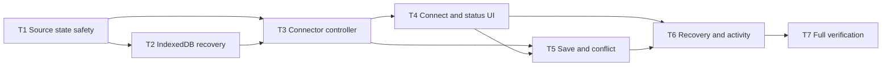

# Tasks: Persistent Local File Connector

> Requirements: @requirements.md
> Design: @design.md
> Status: Approved

## Requirement Coverage

| Requirement | Tasks | Notes |
|---|---|---|
| FR-001 | T3, T4 | Persistent one-file authorization, remembered handle, and workspace activation |
| FR-002 | T4 | Capability-gated snapshot fallback and honest labeling |
| FR-003 | T4 | Safe name, permission, freshness, and exactly one synchronization state |
| FR-004 | T3, T4 | Shared manual/focus source check with validation before activation |
| FR-005 | T1, T2, T5 | Dirty state and recoverable cache without automatic source writes |
| FR-006 | T1, T3, T5 | Conflict transition, blocked writes, and explicit resolution |
| FR-007 | T3, T5 | Confirmation, permission, preflight, write, and post-write verification |
| FR-008 | T2, T4, T6 | Cache-first recovery, truthful labels, and recovery actions |
| FR-009 | T2, T6 | Confirmed browser-state deletion without source mutation |
| FR-010 | T3, T5, T7 | Existing normalization, deterministic checks, views, and export/share boundaries |
| FR-011 | T2, T6 | Path-free local connection activity |
| NFR-001 | T2, T3, T4, T5, T6, T7 | Browser-only data, least privilege, safe names, and no external requests |
| NFR-002 | T1, T2, T3, T5, T7 | Validation, fingerprinting, transactional cache updates, and write preflight |
| NFR-003 | T4, T5, T6, T7 | Keyboard operation, textual status, and inline recovery |
| NFR-004 | T2, T3, T4, T7 | Cache-first restore, metadata short-circuit, and coalesced checks |
| NFR-005 | T3, T4, T7 | Static-host compatibility and visible progressive degradation |

## Implementation Readiness Check

| Check | Status | Notes |
|---|---|---|
| Must Have requirements have tasks | Pass | FR-001 through FR-010 have implementation and verification coverage. |
| Should Have requirements have tasks | Pass | FR-011 is included in T2 and T6. |
| Requirements are covered by design | Pass | Design mapping and sections 4 through 18 cover every requirement. |
| Critical Questions are answered | N/A | Requirements record no critical open questions. |
| Tasks have dependencies, acceptance criteria, files, and verification | Pass | Each task is a bounded local ticket with explicit blocking edges. |
| Verification commands are known or marked manual | Pass | `npm run verify:core` and `npm run build` are configured; native picker prompts remain a documented human smoke test. |
| Out-of-scope boundaries remain excluded | Pass | No directory access, background watcher, merge engine, autosave, backend, or candidate-tool runtime is planned. |

## Implementation Slices

### Safety Foundation Slice

- **Goal:** Establish testable source states, durable recovery, and browser operations without changing the current UI.
- **User Stories:** US-002, US-005
- **Tasks:** T1, T2, T3
- **Independent validation:** Fake-adapter assertions prove restore, refresh, permission, conflict, and write-preflight behavior; the production build remains green.

### Connected Registry Slice

- **Goal:** Let a user connect, revisit, refresh, edit, and deliberately save one canonical registry file.
- **User Stories:** US-001, US-002, US-003, US-004
- **Tasks:** T4, T5
- **Independent validation:** Supported-browser flow exposes persistent source status and prevents a dirty working copy from overwriting an externally changed source.

### Recovery and Evidence Slice

- **Goal:** Complete reauthorization, replacement, export, disconnect, and local activity evidence before release verification.
- **User Stories:** US-003, US-005
- **Tasks:** T6, T7
- **Independent validation:** Permission-loss and disconnect stories preserve or remove only the intended browser data, and final screenshots show the complete desktop/mobile states.

## Dependency Diagram

## Frontier

Work only tasks whose blockers are complete.

| Task | Blocked By | Frontier Status |
|---|---|---|
| T1 | None | Complete |
| T2 | T1 | Complete |
| T3 | T1, T2 | Complete |
| T4 | T3 | Complete |
| T5 | T3, T4 | Complete |
| T6 | T4, T5 | Complete |
| T7 | T6 | Complete |

## Task T1: Define and verify the source synchronization state machine

**Priority:** P0  
**Estimate:** 2h  
**Blocked By:** none  
**Covers:** FR-005, FR-006, NFR-002  
**Delivers:** A pure, deterministic safety model that decides source status and allowed actions before browser persistence or UI integration.

### Work

- [x] Add `RegistrySourceKind`, `SyncState`, permission, fingerprint, file-connection, and extended session types while retaining registry provenance compatibility.
- [x] Implement pure transitions for restore, local edit, unchanged source, valid/invalid external change, permission loss, save preflight, write success, write failure, and conflict resolution.
- [x] Centralize labels and allowed actions so React components do not repeat state switches.
- [x] Start red-green with the approved critical case: dirty working state plus changed source returns `Conflict`, retains the working registry, and disallows writing.
- [x] Add dependency-free assertions for every state transition and invariant.

### Acceptance Criteria

- [x] Exactly one of the five approved synchronization states is returned for every connected session state.
- [x] A local edit becomes `Unsaved changes` without producing any source-write command.
- [x] Changed source plus dirty state always becomes `Conflict` and disables write-back.
- [x] Invalid external content cannot replace the last valid registry.
- [x] Existing `demo` and local registry provenance remains type-compatible.

### Files

- `src/types.ts` - modify source/session types
- `src/lib/source-state.ts` - create pure transitions and action selectors
- `scripts/verify-core.ts` - add synchronization assertions

### Verification

- [x] `npm run verify:core`
- [x] `npm run build`
- [x] Confirm the red case fails before implementation and passes after the transition logic is added.

## Task T2: Add durable connection, recovery-cache, and activity persistence

**Priority:** P0  
**Estimate:** 3h  
**Blocked By:** T1  
**Covers:** FR-005, FR-008, FR-009, FR-011, NFR-001, NFR-002, NFR-004  
**Delivers:** Native IndexedDB persistence for one file handle, a valid working cache, fingerprints, and path-free connector activity, including migration from current localStorage.

### Work

- [x] Create a typed native IndexedDB wrapper with `connections`, `cache`, and `activity` stores and one schema version.
- [x] Commit connection and working-cache changes atomically where they change together.
- [x] Persist dirty state, source kind, accepted fingerprint, freshness, safe source name, and the serializable file handle without exporting connection metadata.
- [x] Migrate a valid `sancussight:v1` value into a snapshot cache only when no IndexedDB cache exists; remove the legacy key only after transaction success.
- [x] Add idempotent load, replace, append-activity, and confirmed disconnect operations.
- [x] Keep an in-memory session usable and return a bounded recovery warning when IndexedDB is unavailable or a transaction fails.
- [x] Add fake IndexedDB/store assertions for migration ordering, atomic replacement, disconnect scope, and path-free activity records.

### Acceptance Criteria

- [x] A file handle and its matching valid cache can be restored from the same origin.
- [x] Dirty working data survives a reload through the cache model.
- [x] Failed migration or replacement cannot delete the prior valid browser state.
- [x] Disconnect removes connection/cache records and never invokes a source write or delete.
- [x] Activity records contain safe source names but no full path, registry content, or raw exception.

### Files

- `src/lib/connection-store.ts` - create IndexedDB schema and operations
- `src/lib/storage.ts` - modify legacy migration/export boundaries
- `src/types.ts` - modify persisted record and activity types
- `scripts/verify-core.ts` - add persistence/migration assertions or use an isolated dependency-free store fake

### Verification

- [x] `npm run verify:core`
- [x] `npm run build`
- [x] Browser storage inspection confirms only the approved stores and fields exist.

## Task T3: Implement the browser file adapter and source controller

**Priority:** P0  
**Estimate:** 4h  
**Blocked By:** T1, T2  
**Covers:** FR-001, FR-004, FR-006, FR-007, FR-010, NFR-001, NFR-002, NFR-004, NFR-005  
**Delivers:** A testable controller for connect, restore, refresh, permission, fingerprint, preflight, verified write, and coalesced source checks.

### Work

- [x] Define `FileConnectorAdapter` and implement the browser adapter with capability detection, one-file JSON picker, permission query/request, read, and writable-stream operations.
- [x] Calculate fingerprints using metadata precheck and SHA-256; force full read/hash for manual refresh and save preflight.
- [x] Route all read content through the existing `normalizeRegistry()` boundary before activation.
- [x] Implement cache-first restore that queries but never requests permission automatically.
- [x] Implement connect and replacement as commit-after-validation workflows that preserve the prior session on cancel, denial, invalid content, or persistence failure.
- [x] Implement manual/focus source checks with one in-flight operation, stale-result protection, and no selected-view reset.
- [x] Implement confirmed-save orchestration with just-in-time read/write permission, source preflight, write, close, reread, and post-write validation.
- [x] Record controlled activity outcomes without paths or raw file content.
- [x] Add a fake adapter and assertions for supported/unsupported capability, restored prompt permission, clean refresh, conflict, preflight write block, successful verified write, and failed write recovery.

### Acceptance Criteria

- [x] Picker and permission requests occur only from understandable user actions.
- [x] Startup with prompt/denied permission retains cache as recovery-only and never claims `Current`.
- [x] A clean valid external revision activates; a dirty revision conflict does not.
- [x] A changed source discovered during save preflight produces zero adapter write calls.
- [x] Successful save is not reported until reread and validation succeed.
- [x] No controller path uploads data, requests a directory, or accepts an arbitrary typed path.

### Files

- `src/lib/file-connector.ts` - create production adapter and capability helpers
- `src/lib/source-controller.ts` - create workflows and operation coordinator
- `src/lib/source-state.ts` - modify transition integration as needed
- `src/lib/session.ts` - modify only if normalization needs an approved connector input option
- `src/lib/connection-store.ts` - modify controller-facing operations
- `scripts/verify-core.ts` - add fake-adapter workflow assertions

### Verification

- [x] `npm run verify:core`
- [x] `npm run build`
- [x] Source scan confirms no directory picker, network request, autosave, or automatic merge path.

## Task T4: Deliver persistent connect, restore, refresh, and source status UI

**Priority:** P0  
**Estimate:** 4h  
**Blocked By:** T3  
**Covers:** FR-001, FR-002, FR-003, FR-004, FR-008, NFR-001, NFR-003, NFR-004, NFR-005  
**Delivers:** The visible connector experience from landing through a restored workspace, with honest snapshot fallback and actionable source status.

### Work

- [x] Refactor `App` to hydrate the extended session through the source controller and preserve route, selected view, selected asset, and notices.
- [x] Replace the supported-browser landing action with `Connect file` and canonical-source helper text.
- [x] Show `Import snapshot` and explicit re-import semantics when persistent file access is unsupported.
- [x] Preserve demo-marked input as demo and prevent it from becoming a canonical actual-data connection.
- [x] Add a compact `SourceStatus` region with safe filename/snapshot name, permission, textual synchronization state, and last successful read.
- [x] Keep `Refresh from source` available for a connected file and expose reauthorization/replacement/export/disconnect through the existing restrained utility pattern.
- [x] Add coalesced `visibilitychange` checking without interrupting dialogs, connector operations, typing, or the selected workspace view.
- [x] Render read, validation, permission, and persistence failures as inline recovery notices with accessible live-region behavior.

### Acceptance Criteria

- [x] Supported browsers can connect one valid registry and return to a workspace that remembers the source handle.
- [x] Unsupported browsers see `Snapshot`, not connector/current wording, and retain import/export behavior.
- [x] Every connected workspace shows safe source name, last read, permission, and exactly one synchronization state in text.
- [x] Manual refresh is keyboard-operable and failed refresh retains the last valid working copy.
- [x] Focus refresh never resets the current tab or silently replaces dirty data.
- [x] Full local paths never appear in UI, notices, exports, share cards, or activity.

### Files

- `src/App.tsx` - modify session orchestration and focus checking
- `src/components/LandingGateway.tsx` - modify progressive connect/snapshot language
- `src/components/Header.tsx` - modify source actions and status ownership
- `src/components/SourceStatus.tsx` - create compact source status controls
- `src/components/ConnectionNotice.tsx` - modify recovery notices
- `src/index.css` - modify responsive/accessibility styling
- `src/types.ts` - modify component contracts as needed

### Verification

- [x] `npm run verify:core`
- [x] `npm run build`
- [x] Browser-check supported and forced-unsupported landing/workspace flows.
- [x] Keyboard-check connect, refresh, reauthorize, replace, export, and menu behavior.
- [x] Browser-check source status and notices at 1280x720 and 390x844 without overlap or page-level horizontal scroll.

## Task T5: Add deliberate write-back and explicit conflict resolution

**Priority:** P0  
**Estimate:** 4h  
**Blocked By:** T3, T4  
**Covers:** FR-005, FR-006, FR-007, FR-010, NFR-001, NFR-002, NFR-003  
**Delivers:** Recoverable local edits, confirmed source writes, and conflict recovery that never chooses or merges versions silently.

### Work

- [x] Route every registry mutation through one session update that marks connected-file work dirty and persists the valid cache without writing the source.
- [x] Add `Save to source` only for dirty connected sessions and keep it disabled/blocked in conflict or permission-recovery states.
- [x] Present a confirmation summary with safe filename, asset count, overwrite meaning, and cancellation that changes nothing.
- [x] Integrate controller preflight/write/post-write results into source status, freshness, cache, and inline notices.
- [x] Add `ConflictPanel` actions for confirmed `Reload source`, `Export working copy`, and `Keep working` while retaining the conflict badge and blocked save.
- [x] Preserve snapshot export behavior without presenting snapshot writes as source maintenance.
- [x] Keep deterministic checks, Overview grouping, Queue, Registry, Exit Test, and share/export provenance behavior unchanged for the accepted working registry.

### Acceptance Criteria

- [x] Connected edits survive reload and show `Unsaved changes` without automatic source mutation.
- [x] Save requires explicit confirmation and just-in-time write permission where needed.
- [x] External change before save enters `Conflict` and leaves the canonical file untouched.
- [x] Reload source requires confirmation before discarding working edits.
- [x] Export working copy does not resolve or hide the conflict.
- [x] Successful verified save returns to `Current`; failed/cancelled save retains recoverable dirty state.
- [x] No automatic merge or autosave behavior exists.

### Files

- `src/App.tsx` - modify centralized registry mutation and save/conflict handlers
- `src/components/Header.tsx` - modify conditional save command
- `src/components/ConflictPanel.tsx` - create explicit recovery panel
- `src/components/ConnectionNotice.tsx` - modify save/conflict outcomes
- `src/lib/source-controller.ts` - modify integration if UI result contracts require it
- `src/lib/storage.ts` - preserve export behavior
- `src/index.css` - add stable conflict and confirmation styling
- `scripts/verify-core.ts` - add mutation/write/conflict assertions

### Verification

- [x] `npm run verify:core`
- [x] `npm run build`
- [x] Use a valid temporary registry to exercise edit, cancel save, grant/deny write, successful write, external edit conflict, reload, and export-working-copy paths.
- [x] Compare deterministic signal output before and after connector integration for the unchanged demo registry.

## Task T6: Complete permission recovery, replacement, disconnect, and activity evidence

**Priority:** P1  
**Estimate:** 3h  
**Blocked By:** T4, T5  
**Covers:** FR-008, FR-009, FR-011, NFR-001, NFR-003  
**Delivers:** A complete recovery lifecycle and locally auditable connection maintenance without exposing filesystem details.

### Work

- [x] Complete reauthorization from `Permission required` using a direct user action and restore `Current`, `Unsaved changes`, or `Conflict` based on a fresh source check.
- [x] Implement transactional replacement that preserves the prior handle/cache until the new source is validated and persisted.
- [x] Provide export-cache recovery when the canonical file is unreadable or missing.
- [x] Require confirmation before disconnect, remove remembered connection/cache/legacy state, preserve path-free activity, and leave the source untouched.
- [x] Merge local connection activity with existing imported/embedded activity in reverse chronological order.
- [x] Render controlled operation, outcome, timestamp, and safe source name without raw exceptions, paths, or registry data.
- [x] Add empty, failed-storage, deleted/moved-file, and permission-denied recovery states with one clear next action each.

### Acceptance Criteria

- [x] Cached data is visibly recovery-only whenever the source cannot be read.
- [x] Reauthorization never occurs automatically and resolves state only after a fresh source check.
- [x] Failed or cancelled replacement preserves the old canonical connection and working cache.
- [x] Disconnect removes browser connection/cache data only and cannot delete or modify the source file.
- [x] Activity shows every required connector event with safe data and remains local.
- [x] Export and replacement remain available when permission cannot be recovered.

### Files

- `src/App.tsx` - modify recovery, replacement, and disconnect handlers
- `src/components/Header.tsx` - modify recovery utilities
- `src/components/ActivityLog.tsx` - modify merged activity rendering
- `src/lib/activity.ts` - modify connection activity normalization/merge
- `src/lib/connection-store.ts` - modify activity and disconnect operations
- `src/lib/source-controller.ts` - modify recovery workflows
- `src/index.css` - modify recovery/activity states
- `scripts/verify-core.ts` - add recovery/disconnect/activity assertions

### Verification

- [x] `npm run verify:core`
- [x] `npm run build`
- [x] Browser-check permission loss, reauthorization, missing file, replacement cancel/failure/success, cache export, and confirmed disconnect.
- [x] Inspect IndexedDB and the source file before/after disconnect to prove only browser state was removed.

## Task T7: Verify and polish the complete connector flow

**Priority:** P0  
**Estimate:** 3h  
**Blocked By:** T6  
**Covers:** FR-010, NFR-001, NFR-002, NFR-003, NFR-004, NFR-005  
**Delivers:** A release-ready connector with consolidated UI/state logic, complete evidence, responsive screenshots, and documented native-browser limitations.

### Work

- [x] Audit connector code for duplicate state switches, competing persistence paths, stale compatibility wrappers, unnecessary concepts, and unsupported actions; consolidate or remove them.
- [x] Confirm only the source controller reaches file APIs and only the connection store reaches IndexedDB.
- [x] Run the complete landing, demo, snapshot fallback, connect, reload, focus/manual refresh, edit, save, conflict, permission recovery, replacement, export, activity, and disconnect story.
- [x] Verify existing deterministic findings, Registry, Overview, Queue, Exit Test, provenance, export, and share behavior against unchanged fixture data.
- [x] Inspect production preview console, network, IndexedDB, downloaded artifacts, and source file effects.
- [x] Capture desktop and 390px screenshots for landing connector availability, `Current`, `Permission required`, `Unsaved changes`, and `Conflict` states.
- [x] Record the native file-picker and permission-prompt human smoke-test limitation in verification evidence.

### Acceptance Criteria

- [x] All Must Have requirements and every task acceptance criterion have fresh verification evidence.
- [x] The UI remains professional and compact with no overlap, clipping, nested-card clutter, or page-level horizontal scroll.
- [x] Every action is keyboard-operable and every status has textual meaning.
- [x] Production runtime makes no external request and exposes no path or file-handle data.
- [x] Demo and snapshot modes never claim canonical-source currency.
- [x] No directory access, watcher, merge engine, autosave, backend, account, or candidate-tool execution was introduced.
- [x] Final screenshots are available for user review.

### Files

- `src/App.tsx` - simplify final orchestration as needed
- `src/components/*.tsx` - refine only connector-related UI and accessibility
- `src/lib/source-*.ts` - consolidate connector logic as needed
- `src/lib/connection-store.ts` - final persistence audit
- `src/index.css` - final responsive polish
- `scripts/verify-core.ts` - complete core assertions
- `.ai/sdd/specs/003-persistent-local-file-connector/tasks.md` - record verification evidence during execution

### Verification

- [x] `npm run verify:core`
- [x] `npm run build`
- [x] `rg -n -i "fetch\(|axios|supabase|websocket|eventsource|showDirectoryPicker" src package.json`
- [x] Production preview console/network/storage inspection.
- [x] Browser flow verification and screenshot inspection at 1280x720 and 390x844.
- [x] Human smoke test of native picker and permission prompts, or an explicit release caveat if unavailable.

## Verification Evidence

### T1 - 2026-07-12

- Red: `npm run verify:core` exited 1 with `ERR_MODULE_NOT_FOUND` before `source-state.ts` existed.
- Green: `npm run verify:core` exited 0; provenance, grouping, route, and source-state assertions passed.
- Build: `npm run build` exited 0; TypeScript and Vite production build passed.

### T2 - 2026-07-12

- Red: `npm run verify:core` exited 1 with `ERR_MODULE_NOT_FOUND` before `connection-store.ts` existed.
- Green: `npm run verify:core` exited 0 with migration, safe-name, activity, and disconnect assertions.
- Build: `npm run build` exited 0.
- Browser: agent-browser evaluation against Vite confirmed stores `activity`, `cache`, `connections`; cache existed before disconnect, safe source name was `ai-registry.json`, and disconnect removed connection/cache while retaining one activity record.

### T3 - 2026-07-12

- Red: `npm run verify:core` exited 1 before `source-controller.ts` existed.
- Green: `npm run verify:core` exited 0 with connect, clean refresh, permission-required restore, verified write, failed-write recovery, and changed-source preflight assertions.
- Build: `npm run build` exited 0.
- Source scan: no `showDirectoryPicker`, network client, interval watcher, autosave, or merge path was found in the connector modules.

### T4 - 2026-07-12

- Core/build: `npm run verify:core` and `npm run build` both exited 0.
- Browser capability: secure Chromium landing rendered `Connect file`; deleting the picker capability and routing to landing rendered `Import snapshot` with explicit re-import language.
- Browser layout: desktop and 390x844 checks reported no page-level horizontal overflow; mobile header/source regions had stable non-overlapping bounds.
- Screenshot: `artifacts/screenshots/spec003-t4-mobile.png`.

### T5 - 2026-07-12

- Core/build: `npm run verify:core` and `npm run build` exited 0; controller assertions cover preflight conflict, verified save, and failed-write recovery.
- Browser: an OPFS-backed connected workspace changed to `Unsaved changes` after `Record review today`; the dirty cache persisted without a source write.
- Conflict: after an external OPFS edit, manual refresh rendered `Conflict`, disabled `Save to source`, retained the working registry, and exposed Reload/Export/Keep working actions.
- Screenshot: `artifacts/screenshots/spec003-conflict-desktop.png`.

### T6 - 2026-07-12

- Core/build: `npm run verify:core` and `npm run build` exited 0 with replacement-cancel, disconnect-no-write, activity merge/dedupe, and prior recovery assertions.
- Activity: browser Activity view contained local `source-conflict` evidence and retained the existing embedded activity.
- Disconnect: OPFS-backed source still existed after confirmation; IndexedDB connection/cache were absent; newest activity operation was `disconnect`.

### T7 - 2026-07-12

- Commands: `npm run verify:core`, `npm run build`, and `git diff --check` exited 0.
- Source scans: no network client, directory picker, interval watcher, gradient, or explicit letter-spacing path was found; expected no-match scans exited 1.
- Production preview: only local JS, CSS, and workspace WebP loaded; external resource list was empty; browser error list was empty; no horizontal overflow.
- Screenshots: `spec003-landing-desktop.png`, `spec003-current-desktop.png`, `spec003-unsaved-mobile.png`, `spec003-permission-required-desktop.png`, `spec003-conflict-desktop.png`, and `spec003-t4-mobile.png`.
- Native follow-up: complete on 2026-07-24. The target-Chromium operating-
  system picker accepted a populated disposable registry; a local mutation
  became `Unsaved changes`; explicit `Save to source` provisioned
  `Write: granted` and completed the deliberate write path.

Populate later tasks with exact commands, exit codes, summaries, screenshots, and any manual-browser limitations. Task checkboxes remain incomplete until fresh evidence exists.
