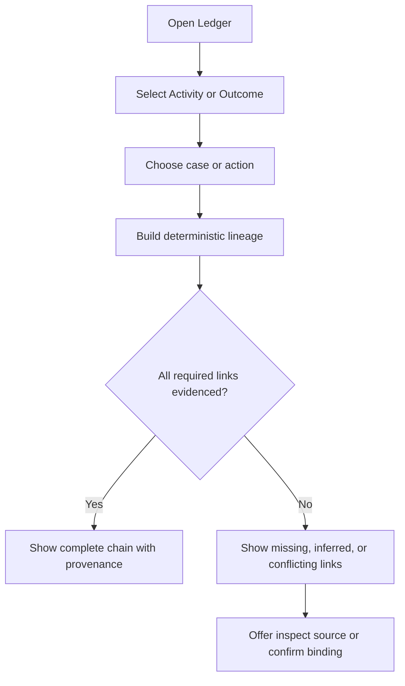
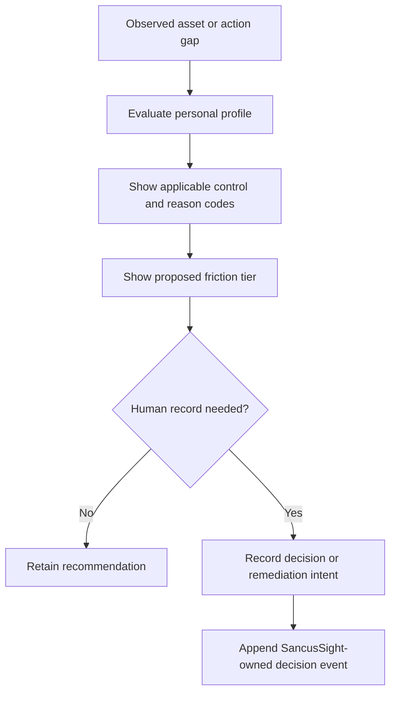

# Design: Local Agent Governance Ledgers

> Requirements: @requirements.md
> Status: Approved

## 1. Summary

Add a versioned `GovernanceEventV1` contract and a pure projection layer above the existing registry and evidence collector. SancusSight will present five related ledger views - Inventory, Activity, Controls, Decisions, and Outcomes - plus a lineage inspector that connects work intent to verified outcome only when stable identity or a user-confirmed binding supports the relationship.

The design extends rather than replaces Specs 004 and 005. Existing `EvidenceEnvelopeV1` records remain canonical for Agent Beacon, Praxen, Pipelock, RAMPART, and AIMap and are projected deterministically into governance events at the read-model boundary. FindMnemo, FlowSensa, local inventory producers, and SancusSight-owned human decisions can emit native governance events. SancusSight never gains upstream command, scan, test, or policy-mutation authority.

The first release uses deterministic control applicability and friction recommendations. Probabilistic recommendations may be imported as explicitly inferred events, but the product makes no model or external network calls and never uses inferred content to grant authority or prove enforcement.

## 2. Requirements Mapping

| Requirement | Design Coverage |
|---|---|
| FR-001 | Sections 5.1-5.4 define `GovernanceEventV1`, typed payloads, IDs, validation, and provenance. |
| FR-002 | Sections 5.5 and 8.1 define logical assets and the Inventory projection. |
| FR-003 | Sections 4, 6.3, and 8 define the five ledger projections over one event model. |
| FR-004 | Section 6.1 defines FindMnemo adapters and accepted profiles. |
| FR-005 | Section 6.2 defines FlowSensa adapters and truth-preserving workflow projections. |
| FR-006 | Sections 3 and 6.3 preserve Specs 004/005 contracts through deterministic projection. |
| FR-007 | Sections 5.6 and 7 define correlation, bindings, conflicts, and lineage gaps. |
| FR-008 | Sections 5.3, 7.2, and 8.6 separate truth, authority, qualification, and verification. |
| FR-009 | Sections 5.3, 9.1, and TD-006 reserve authoritative outcomes for deterministic evidence. |
| FR-010 | Sections 9.2-9.4 define the curated personal control profile and applicability rules. |
| FR-011 | Sections 9.5 and 10 define observe, advise, confirm, and block recommendations. |
| FR-012 | Sections 5.7 and 6.5 define immutable, action-bound human decisions. |
| FR-013 | Sections 3, 6.4, and 11 preserve the read-only upstream boundary. |
| FR-014 | Sections 6 and 11 define file-path and collector ingestion with source isolation. |
| FR-015 | Sections 5.4, 6, and 11 define allowlists, sanitization, and prohibited content. |
| FR-016 | Sections 7.3 and 12 define source and relationship degradation. |
| FR-017 | Sections 5.5, 11, and 13 define the sanitized governance bundle projection. |
| FR-018 | Sections 7.3, 9.4, and 12 define material-change detection and reassessment gaps. |
| FR-019 | Sections 3, 5.3, 6.3, and 9.5 define action-bound upstream enforcement evidence. |
| FR-020 | Sections 5.3 and 9.1 constrain future feedback to non-authoritative recommendation ordering. |
| NFR-001 | Sections 6.4, 11, and 13 cover loopback security, CSRF, least authority, and key exclusion. |
| NFR-002 | Sections 5.4, 6, and 13 cover minimization, safe names, and export sanitization. |
| NFR-003 | Sections 6.6, 7.3, and 12 cover append-only persistence, checkpoints, replay, rotation, and isolation. |
| NFR-004 | Sections 5.3, 7, 8.6, and 14 preserve claim provenance and truth distinctions. |
| NFR-005 | Sections 8 and 9 define prioritized gaps and consequence-based friction. |
| NFR-006 | Section 10 defines keyboard, textual state, responsive, and reduced-motion behavior. |
| NFR-007 | Sections 6.6 and 14 define indexed projections, paging, and the 100,000-event test seam. |
| NFR-008 | Sections 3, 6.1, 6.3, and 15 define compatibility and staged rollout. |

## 3. Architecture and Trust Boundaries

```text
FindMnemo exports       FlowSensa exports       Runtime inventory exports
       |                       |                          |
       +----------- fixed read-only adapters ------------+
                                  |
Agent Beacon / Praxen / Pipelock / RAMPART / AIMap EvidenceEnvelopeV1
                                  |
                     deterministic compatibility projector
                                  |
                    GovernanceEventV1 validated event stream
                                  |
                    shared pure governance projection engine
                                  |
         Inventory | Activity | Controls | Decisions | Outcomes
                                  |
                        lineage + gap inspector
                                  |
                 SancusSight read-only governance UI

Upstream enforcement boundary: runtime / harness / MCP gateway / Pipelock
SancusSight-owned write boundary: explicit human decisions and bindings only
```

There are four authority domains:

1. **Producer domain:** Agents and tools create their own artifacts. Agent-authored records are declared context unless independently observed.
2. **Enforcement domain:** Runtime hooks, harnesses, MCP gateways, and Pipelock can evaluate or constrain actions. Only qualifying action-bound evidence receives `enforced` authority.
3. **Collector domain:** Fixed adapters read configured paths, validate known contracts, and store minimized normalized records. It cannot execute producer commands.
4. **SancusSight domain:** The shared projector evaluates evidence and the UI records SancusSight-owned human decisions or bindings. It cannot mutate upstream policy or activity.

## 3a. Research / Prototype Inputs

- Research: `artifacts/research/local-agent-governance-layer-assessment.md`
- Interactive concept: `artifacts/research/local-agent-governance-layer-explainer.html`
- Existing collector design: `.ai/sdd/specs/004-local-evidence-collector/design.md`
- Operational source design: `.ai/sdd/specs/005-operational-evidence-producers/design.md`
- FindMnemo work-event and observed-work contracts in the canonical FindMnemo repository
- FlowSensa WorkEvent schema and FindMnemo telemetry adapter in the canonical FlowSensa repository
- External references: Singapore Model AI Governance Framework for Agentic AI, CSA AICM v1.1, Credo Agent Governance Configuration, and the Agent Governance Layer reference architecture

## 4. Component and Module Structure

```text
contracts/
  governance-event.v1.schema.json
  findmnemo-governance-source.v1.schema.json
  flowsensa-governance-source.v1.schema.json
  human-decision.v1.schema.json
controls/
  personal-agentic.v1.json
collector/
  governance-event.ts          validation, canonicalization, deterministic ID
  governance-store.ts          native event, rejection, checkpoint persistence
  governance-service.ts        paging, filters, decisions, projection access
  adapters/
    findmnemo.ts               observed-work and WorkEvent adapter
    flowsensa.ts               workflow/process evidence adapter
    runtime-inventory.ts       approved local inventory snapshot adapter
  projections/
    evidence-envelope.ts       EvidenceEnvelopeV1 -> GovernanceEventV1
  __tests__/
    governance-*.test.ts
src/
  domain/governance/
    model.ts                    event, entity, relation, read-model types
    canonicalize.ts             canonical refs and bindings
    project.ts                  pure five-ledger read-model builder
    lineage.ts                  deterministic graph and gap analysis
    controls.ts                 profile applicability and friction rules
    export.ts                   sanitized bundle projection
  lib/
    governance-client.ts        same-origin API and hosted/manual fallback
    governance-snapshot-store.ts
    use-governance.ts
  components/governance/
    GovernanceWorkspace.tsx
    GovernanceTabs.tsx
    InventoryLedger.tsx
    ActivityLedger.tsx
    ControlLedger.tsx
    DecisionLedger.tsx
    OutcomeLedger.tsx
    LineageInspector.tsx
    GovernanceDetail.tsx
    RecommendationDetail.tsx
```

Shared domain code must remain free of Node and browser globals so the collector and hosted browser mode execute the same projection rules. Existing `EvidenceLedger`, `EvidenceSources`, and registry components are composed into `GovernanceWorkspace`; they are not duplicated under a competing navigation system.

## 5. Data Model and State

### 5.1 Governance event envelope

```ts
type GovernanceEventType =
  | 'inventory.observed'
  | 'inventory.removed'
  | 'work.intent-recorded'
  | 'action.proposed'
  | 'action.observed'
  | 'control.decided'
  | 'human.decided'
  | 'effect.observed'
  | 'outcome.observed'
  | 'outcome.verified'
  | 'finding.observed'

interface GovernanceEventV1 {
  schemaVersion: 1
  id: string
  type: GovernanceEventType
  observedAt: string
  importedAt: string
  source: GovernanceSource
  subject: CanonicalRef
  context: GovernanceContext
  truth: GovernanceTruth
  payload: GovernancePayload
  relations: GovernanceRelation[]
  provenance: GovernanceProvenance
}
```

`payload` is a discriminated union keyed by `type`; it is not an unrestricted `Record<string, unknown>`. Every payload schema has bounded strings, arrays, and allowlisted enums. Unknown event types or additional sensitive fields reject the complete record.

### 5.2 Canonical references

```ts
type LogicalAssetKind =
  | 'agent' | 'runtime' | 'model' | 'mcp-server' | 'tool' | 'plugin'
  | 'loop' | 'workflow' | 'policy' | 'permission-set' | 'data-object'
  | 'control' | 'work-case' | 'action' | 'approval' | 'effect' | 'outcome'

interface CanonicalRef {
  kind: LogicalAssetKind
  id: string
  namespace: string
  label?: string
}
```

Use an upstream stable ID when its contract declares it portable. Otherwise derive an opaque local ID as SHA-256 of canonical `kind`, producer namespace, and bounded external ID. Raw paths, prompts, or labels never participate in cross-source identity. Display labels are optional, bounded, and non-authoritative.

### 5.3 Truth, authority, qualification, and verification

```ts
interface GovernanceTruth {
  assertion: 'declared' | 'observed' | 'inferred' | 'human-confirmed' | 'enforced' | 'verified'
  authority: 'agent' | 'runtime' | 'workflow-system' | 'policy-engine' | 'human' | 'assurance-tool' | 'sancussight'
  confidence?: number
}
```

Operational qualification and cryptographic verification remain separate fields in provenance and retain the Spec 005 semantics. `assertion: 'enforced'` requires a qualifying in-path producer, stable action binding, policy identity, and supported verification state. `inferred` always requires confidence and evidence references and cannot satisfy authorization, control-effectiveness, or readiness checks.

### 5.4 Provenance and deterministic IDs

Provenance records producer ID/version, source record ID, artifact safe name and hash, parser ID/version, contract version, verification, and qualification. The event ID is SHA-256 of canonical event type, source identity, source record identity or canonical payload, subject, relations, and parser major version. `importedAt` is excluded so replay is idempotent.

Raw prompts, responses, chain-of-thought, credentials, private keys, unrestricted arguments, unrestricted command output, and full workspace content are prohibited schema fields. Adapter sanitizers run before validation and rejection guidance names only safe artifact names and field categories.

### 5.5 Five ledger projections

The five ledgers are read-model projections, not five independent files:

- **Inventory:** latest qualified state per logical asset plus source history and gaps.
- **Activity:** chronological work, action, effect, and finding events with bounded paging.
- **Controls:** applicable profile controls, upstream policy decisions, assurance evidence, and effectiveness gaps.
- **Decisions:** immutable human decisions, upstream policy decisions, overrides, exceptions, expiry, and revocation.
- **Outcomes:** effects, validation, accepted outcomes, failures, rollback, and verification.

This prevents divergent copies while allowing each view to optimize for its task.

### 5.6 Relations and bindings

Relations use allowlisted types such as `initiated-by`, `part-of-case`, `proposed-by`, `evaluated-by`, `approved-by`, `executed-as`, `produced`, `validated-by`, and `supersedes`. A relation is `observed`, `confirmed`, `inferred`, `conflicting`, or `unresolved`.

Automatic links are allowed only when both records carry the same portable stable ID or the same source contract supplies an explicit relation. Existing user-confirmed evidence bindings remain valid and migrate to typed bindings. Fuzzy time, label, path, or semantic similarity may suggest a link but cannot create one without confirmation.

### 5.7 Human decisions

```ts
interface HumanDecisionPayload {
  decision: 'approve' | 'reject' | 'override' | 'exception' | 'revoke'
  actionId: string
  policyId: string
  policyVersion: string
  scopeHash: string
  rationale: string
  decidedBy: string
  effectiveAt: string
  expiresAt?: string
  supersedesDecisionId?: string
  evidenceRefs: string[]
}
```

Decisions are append-only. Revocation and replacement create new events. The projector considers a decision active only when action, policy version, scope hash, time, and supersession state match. Model-generated advice can be linked as evidence but is never copied into `rationale` without explicit user confirmation.

## 6. Source and Adapter Contracts

### 6.1 FindMnemo

The adapter accepts two existing versioned inputs:

1. `findmnemo.observed-work.v1` personal-ontology bundles for objects, links, decisions, evidence references, and handoffs.
2. WorkEvent `1.0.0` collections using current or legacy `sourceType: 'mnemosync'` identifiers for case, trace, actor, activity, result, resources, and accepted outcome.

The adapter emits declared intent and object context for user/agent authored records and observed workflow facts only where the source truth state says observed. Legacy `mnemosync://` references remain readable and map to the FindMnemo namespace without rewriting source records.

### 6.2 FlowSensa

The adapter accepts a versioned governance projection exported by FlowSensa. It includes source WorkEvent references, discovered workflow/transition identities, handoffs, resource measurements, outcome observations, and process-risk findings. Derived process models remain `inferred` and include method/version and confidence when available. FlowSensa cannot promote an inferred workflow link into observed lineage.

### 6.3 Existing assurance sources

`projectEvidenceEnvelope()` converts Spec 004/005 envelopes into governance events without copying or persisting a second canonical record. The governance event provenance points to the original evidence ID. Qualification, verification, outcome, source health, and freshness are preserved exactly. This projector supports Agent Beacon, Praxen, Pipelock, RAMPART, and AIMap after Spec 005 extends the source union.

### 6.4 Runtime inventory producer

The first inventory contract is an explicitly generated, read-only snapshot for Codex CLI and Claude Code containing allowlisted runtime version, configured model label, MCP server identity, tool/plugin identity, policy/permission-set references, enabled state, and observed time. It excludes environment variables, tokens, configuration secrets, prompt files, and unrestricted command lines. SancusSight does not enumerate the machine through arbitrary paths.

### 6.5 SancusSight decisions and bindings

Local mode adds fixed endpoints for SancusSight-owned `human.decided` events and confirmed bindings. The endpoints accept only typed bodies, require same-origin session/CSRF checks, validate referenced events, and cannot alter producer artifacts or upstream policy. Hosted/manual mode stores the same records in IndexedDB and includes them in explicit governance export.

### 6.6 Persistence and scale

- Keep existing `evidence.jsonl`, `rejected.jsonl`, and checkpoints as Spec 004/005 canonical storage.
- Add `governance-events.jsonl`, `governance-rejected.jsonl`, and `governance-checkpoints.json` for native FindMnemo, FlowSensa, inventory, decision, and binding events.
- Initialize in-memory indexes by event ID, subject ID, case ID, action ID, type, and observed time.
- Page API results by opaque cursor with a maximum server-controlled page size.
- Support 100,000 active native plus projected events. Compaction retains the newest bounded event set by source while preserving decisions, revocations, bindings, and events referenced by active lineage; any later archival policy requires separate approval.
- Advance a source checkpoint only after accepted events and the checkpoint are durably written. One source failure cannot block another source.

## 7. Correlation and Lineage

### 7.1 Projection sequence

1. Load native governance events and existing evidence envelopes.
2. Project evidence envelopes into ephemeral governance events.
3. Validate IDs, relations, truth, qualification, verification, and timestamps.
4. Apply explicit registry bindings and SancusSight binding events.
5. Build entity and relation indexes.
6. Resolve only stable or confirmed links.
7. Detect missing, conflicting, expired, revoked, or stale links.
8. Produce the five ledgers, lineage summaries, and control inputs.

### 7.2 Lineage truth

The canonical path is:

```text
work intent -> agent/runtime -> proposed or observed action
            -> policy decision -> human decision when required
            -> observed effect -> observed outcome -> verified outcome
```

Every edge displays its basis. A complete-looking chain with an inferred or missing edge remains incomplete for audit and control-effectiveness purposes. Raw chain-of-thought is neither required nor accepted; action proposals, bounded rationale, source references, decisions, and effects are sufficient.

### 7.3 Conflict and degradation

- Two sources claiming different versions or owners produce a conflict group; neither silently wins.
- A stale source degrades current claims but does not rewrite historical truth.
- A removed inventory asset remains in history and appears removed only after a qualifying removal event.
- Expired or revoked decisions remain visible but inactive.
- A missing effect prevents an action from appearing executed.
- A verified outcome without a traceable effect is visible as evidence with a lineage gap.

## 8. Read Model and UI

### 8.1 Navigation

Extend the current `LEDGER` workspace instead of adding five top-level navigation destinations. A compact tab row switches between `Inventory`, `Activity`, `Controls`, `Decisions`, and `Outcomes`. `Lineage` opens as an unframed inspector for the selected case/action and remains reachable from every ledger row.

### 8.2 Default view

Open on a concise governance summary ordered by consequence:

1. consequential unresolved gaps;
2. expired or conflicting approvals;
3. failed or unverified enforcement claims;
4. changed inventory requiring reassessment;
5. routine current observations.

Do not lead with framework scores or all control rows.

### 8.3 Inventory

Use a dense table grouped by agent/runtime, MCP/tool, workflow/loop, and policy/control. Columns show asset, kind, source-qualified state, purpose/owner gaps, version, permissions summary, connected systems, policy coverage, last observed, and lineage count. Selection opens provenance and history without nesting cards.

### 8.4 Controls and good friction

Controls show applicable local controls and observed upstream policy decisions. Each recommendation displays evidence basis, consequence, proposed friction tier, required proof, framework references, and whether any enforcement evidence exists. The call to action is a human decision or remediation record, never `Apply`, `Run`, or `Block now`.

### 8.5 Decisions and outcomes

Decisions group policy and human decisions by canonical action, showing active, expired, revoked, conflicting, or unmatched state. Outcomes distinguish proposed action, observed effect, user-accepted result, test result, rollback, and verification. A block receipt is an outcome of policy enforcement, not proof that every similar future action is protected.

### 8.6 Truth presentation

Every detail inspector includes four separate rows: `Assertion`, `Authority`, `Qualification`, and `Verification`. Text labels always accompany color. `Observed`, `Inferred`, `Human-confirmed`, `Enforced`, and `Verified` are never collapsed into one generic trusted state.

## 9. Personal Control Profile and Recommendation Engine

### 9.1 Deterministic engine

`evaluatePersonalControls(readModel, profile, now)` is a pure function. It consumes normalized asset/action facts and never raw prompts or arbitrary source payloads. It returns control applicability, evidence gaps, and a proposed friction tier with deterministic reason codes.

### 9.2 Profile structure

`personal-agentic.v1.json` contains a curated set of local controls grouped under Singapore's four dimensions:

- assess and bound risk;
- meaningful human accountability;
- technical controls and lifecycle processes;
- responsible end-user use.

Each control records a SancusSight ID, plain-language outcome, deterministic applicability predicates, expected evidence types, default friction tier, and attributed external references. AICM references use control IDs and permitted attribution; the source workbook is not copied into the repository or UI.

### 9.3 Initial control families

- known agent/runtime and named purpose;
- approved MCP/tool inventory;
- least privilege and session-bounded permissions;
- external destination and sensitive-data handling;
- consequential action approval and expiry;
- action/effect/outcome lineage;
- source freshness and log integrity;
- behavior evaluation and red-team evidence;
- rollback, containment, and incident evidence;
- material-change reassessment.

### 9.4 Applicability

Rules evaluate explicit facts such as external destination, sensitive classification, write/delete/publish effect, privilege level, reversibility, permission breadth, policy presence, source qualification, novelty since last approved inventory, and active approval match. Unknown facts produce an evidence gap rather than a permissive default.

### 9.5 Friction tiers

| Tier | Recommendation semantics | Typical deterministic conditions |
|---|---|---|
| Observe | Record without interrupting. | Approved local read, known workspace, no sensitive egress or privilege change. |
| Advise | Non-blocking explanation and evidence request. | New low-impact tool or MCP server with bounded permissions and no consequential effect. |
| Confirm | Require action-bound, expiring human approval upstream. | External publish/write, new destination, credential use, privileged action, low reversibility. |
| Block | Recommend deterministic upstream denial and specific remediation. | Explicit prohibited destination/action, detected secret egress, destructive out-of-scope effect, invalid or revoked authority. |

SancusSight describes the recommended control. Only qualifying upstream receipts may state that an action was actually allowed or blocked.

## 10. User Flows and Accessibility

### 10.1 Trace a case



### 10.2 Review a control



Tabs use native buttons with `aria-selected`; ledgers use semantic tables at desktop and labeled row groups on narrow screens. The inspector returns focus to its originating row. Keyboard users can change tabs, open lineage, inspect provenance, and record a decision. Motion is limited to optional inspector transitions and disabled under reduced motion. Stable row heights, bounded labels, and horizontal table scrolling prevent content overlap.

## 11. API and Integration Contract

Existing endpoints remain compatible. Add:

| Method | Path | Purpose |
|---|---|---|
| `GET` | `/api/v1/governance/events` | Paged native and projected events with bounded filters. |
| `GET` | `/api/v1/governance/inventory` | Paged latest logical-asset projection. |
| `GET` | `/api/v1/governance/lineage/:id` | One bounded case/action lineage and gap summary. |
| `GET` | `/api/v1/governance/controls` | Applicable personal controls and recommendations. |
| `POST` | `/api/v1/governance/decisions` | Append one validated SancusSight-owned human decision. |
| `POST` | `/api/v1/governance/bindings` | Append one confirmed source/entity binding. |

Filters are allowlisted enums and bounded opaque IDs. No endpoint accepts a source path except the existing known-source configure route. State-changing requests require the existing session and CSRF protections. There is no execute, install, run, scan, approve-upstream, policy-write, or arbitrary query endpoint.

Hosted mode imports a sanitized governance bundle, runs the same shared projector in the browser, and persists the manual snapshot plus SancusSight-owned decisions in IndexedDB. It makes no localhost or external request.

## 12. Edge Cases

| Case | Expected Behavior |
|---|---|
| Unknown governance schema or event type | Reject the complete record with supported-version guidance; other sources continue. |
| Same event replayed | Deterministic ID prevents duplication; checkpoint may advance only after durable success. |
| FindMnemo legacy identifier | Accept and namespace as legacy-compatible without rewriting the source record. |
| FlowSensa inferred process conflicts with observed action order | Show conflict; observed source order remains authoritative for the event, while the process model remains inferred. |
| Fuzzy candidate link | Show a suggested unresolved link; require confirmation before lineage uses it. |
| Approval action or scope mismatch | Mark unmatched; never reuse for the proposed action. |
| Approval expired or revoked | Retain history, mark inactive, and recommend fresh confirmation where required. |
| Source becomes stale | Retain evidence, degrade affected current claims, and leave unrelated sources current. |
| Inventory source omits a formerly observed asset | Do not mark removed until a qualifying removal observation or confirmed decision exists. |
| Model recommendation lacks confidence/evidence | Reject as incompatible inferred evidence. |
| Enforcement receipt lacks action or policy binding | Display as unmapped source evidence, not an enforced lineage step. |
| Event count reaches active limit | Compact only according to retention invariants; preserve referenced decisions and report retained range. |
| Hosted mode | Show manual snapshot qualification and keep all projections local to the browser. |

## 13. Security, Permissions, and Privacy

- Keep loopback same-origin host, Origin, session, CSRF, body-size, and content-type checks from Spec 004.
- Adapter configuration accepts only catalogued source IDs and validates source shape before persistence.
- Keep producer paths outside collector-owned directories; store paths only in restricted collector configuration.
- Use field allowlists and bounded values before events enter persistence or logs.
- Never retain raw prompt/response bodies, chain-of-thought, secrets, tokens, private keys, unrestricted tool arguments, unrestricted command output, or unrestricted workspace content.
- Never infer enforcement from an agent declaration or recommendation.
- Human decisions can affect SancusSight's governance view but cannot mutate upstream policy or execute the referenced action.
- Export replaces identifying absolute paths and device/user identifiers with stable sanitized aliases while preserving internal referential integrity.

## 14. Verification Strategy

### Unit and contract

- Validate every event and payload variant, field bound, prohibited field, and unknown version.
- Verify deterministic event and canonical-ref IDs across property order and replay.
- Test truth/authority rules so inferred or declared records cannot satisfy enforcement, approval, effectiveness, or readiness.
- Test stable-ID, source-relation, confirmed-binding, conflict, missing-link, expiry, revocation, and supersession behavior.
- Test each personal control predicate and friction reason code at boundaries.
- Test FindMnemo current and legacy profiles and FlowSensa observed/inferred distinctions.
- Test EvidenceEnvelope projections preserve qualification, verification, freshness, and source identity.

### Collector and API

- Source restart, collector restart, duplicate replay, rotation, partial failure, incompatible contract, and checkpoint atomicity.
- Same-origin/session/CSRF rejection for decisions and bindings.
- Verify no route or dependency exposes process execution, scanning, policy mutation, or arbitrary filesystem reads.
- Import and page 100,000 minimized events; verify bounded response sizes, stable cursors, and accurate projections.

### UI and accessibility

- Desktop and mobile checks for each ledger, lineage complete/gap/conflict states, recommendation tiers, and decision expiry/revocation.
- Keyboard tab/row/inspector/decision flow, visible focus, screen-reader labels, reduced motion, and no horizontal page overflow.
- Hosted/manual, local collector, stale, failed, source-conflict, and empty states.
- Confirm every simulated/demo state is labeled and cannot be mistaken for operational evidence.

### Project commands

- `npm run test:collector`
- `npm run verify:core`
- `npm run build`
- `npm audit`

**Preferred test seam:** `buildGovernanceReadModel()` receives registry, native governance events, evidence envelopes, source states, bindings, control profile, and current time, and returns all five ledgers, lineage gaps, and recommendations.

**First red/green test:** combine a FindMnemo intent event, Agent Beacon action observation, Pipelock decision receipt, and FlowSensa accepted outcome with one shared case/action identity. The projector must produce one complete lineage. Removing the Pipelock action binding must change only that edge to unresolved and prevent the control from appearing enforced.

## 15. Migration and Rollout

Use expand-contract:

1. Add the governance contract, shared projector, and fixtures without changing existing UI behavior.
2. Project current Spec 004/005 evidence envelopes and prove parity with existing evidence signals.
3. Add native FindMnemo and FlowSensa adapters behind catalog readiness.
4. Add governance API paging and hosted snapshot compatibility.
5. Introduce the tabbed Governance workspace while retaining existing Registry, Queue, Exit Test, source rail, and release evidence behavior.
6. Add SancusSight-owned decisions and bindings.
7. Add the personal control profile and deterministic recommendations.
8. Remove only duplicated presentation paths after parity and review; do not delete `EvidenceEnvelopeV1` or existing imports in this spec.

Implementation should begin after Spec 005 stabilizes the five-source envelope and qualification extensions. Spec 006 may add contract/projector tests earlier, but it must not rewrite unfinished Spec 005 behavior.

Rollback disables the new governance workspace and adapters while leaving registry, evidence envelopes, source configurations, and source artifacts intact. Native governance events remain exportable and are not silently deleted.

## 16. Technical Decisions

### TD-001: One event model, five projections

- **Decision:** Store interoperable governance events and derive five ledger views.
- **Why:** Independent ledgers would duplicate facts and drift.
- **Trade-off:** Projection logic and indexes become a shared critical seam.
- **Alternative:** Five separate schemas/files; rejected due to correlation and consistency burden.

### TD-002: Expand beside EvidenceEnvelopeV1

- **Decision:** Keep existing evidence canonical and project it into governance events.
- **Why:** Specs 004/005 already define source-specific verification and qualification semantics.
- **Trade-off:** The projector initially reads two canonical stores.
- **Alternative:** Immediate migration to GovernanceEventV1; rejected as unnecessary release-risk and scope collision with Spec 005.

### TD-003: Stable or confirmed links only

- **Decision:** Automatic canonical lineage uses portable IDs or explicit source relations; other candidate links require confirmation.
- **Why:** False lineage is more dangerous than a visible gap.
- **Trade-off:** More unresolved records and occasional binding decisions.
- **Alternative:** Fuzzy time/name correlation; retained only for non-authoritative suggestions.

### TD-004: Shared pure projector

- **Decision:** Use the same side-effect-free domain functions in collector and browser modes.
- **Why:** Hosted and local views must not disagree about truth, controls, or lineage.
- **Trade-off:** Domain code cannot depend on Node or browser APIs.
- **Alternative:** Server-only read model; rejected because hosted/manual mode is a required compatibility path.

### TD-005: Curated controls, not framework UI

- **Decision:** Ship a small versioned personal profile with attributed framework references.
- **Why:** Enterprise catalogues create noise and may have redistribution constraints.
- **Trade-off:** Coverage is intentionally narrower and requires explicit profile evolution.
- **Alternative:** Import all AICM controls into the UI; rejected as burdensome and outside scope.

### TD-006: Deterministic recommendations in the first release

- **Decision:** The in-product engine uses explicit facts and rules; probabilistic outputs are optional imported inferred evidence.
- **Why:** Steering prohibits external runtime calls, and authority must remain deterministic.
- **Trade-off:** Ambiguous activity may remain unclassified until a source or human supplies context.
- **Alternative:** Embedded model scoring; rejected for privacy, reproducibility, authority, and runtime-dependency reasons.

### TD-007: Explicit SancusSight-owned decision writes

- **Decision:** Allow typed append-only human decision and binding events while prohibiting upstream writes.
- **Why:** Human accountability requires durable local decisions without making SancusSight an agent operator.
- **Trade-off:** The product has a narrow write surface that requires security and hosted-mode parity tests.
- **Alternative:** Store decisions only in mutable UI state; rejected because provenance, expiry, and export would be unreliable.

### TD-008: Consequence-based friction without opaque score

- **Decision:** Emit a tier plus deterministic reason codes from explicit factors, not a single AI risk score.
- **Why:** Users need to understand and challenge why friction increased.
- **Trade-off:** Rules are more verbose and need boundary tests.
- **Alternative:** Composite numeric risk score; rejected because it hides materially different causes behind one number.

## 17. Risks

| Risk | Impact | Mitigation |
|---|---|---|
| Spec 006 collides with unfinished Spec 005 contracts | Rework or weakened release gate | Expand-contract; begin integration only after Spec 005 envelope/qualification stabilization. |
| Producer self-report is mistaken for observation | False trust | Explicit truth and authority, source qualification, and UI separation. |
| Incorrect cross-source correlation | False lineage and control claims | Stable IDs, explicit relations, confirmed bindings, and visible unresolved states. |
| Event model becomes an unrestricted dumping ground | Privacy and maintenance failure | Discriminated payloads, JSON Schemas, allowlists, size bounds, and reject-unknown. |
| Five tabs increase navigation burden | Product complexity | Keep one Ledger workspace, consequence-first default, shared detail inspector. |
| Control catalogue overwhelms the user | Alert fatigue | Curated profile, applicability predicates, evidence-linked recommendations, no framework score wall. |
| Human decisions appear to enforce upstream behavior | Misleading protection claim | Separate recommendation, human decision, and enforced receipt states. |
| 100,000 events slow startup or browser rendering | Poor usability | In-memory indexes, server paging, bounded browser projections, virtualization only where measured. |
| Retention removes evidence referenced by active decisions | Broken audit chain | Pin referenced events during compaction and test retention invariants. |
| Probabilistic suggestions influence authority | Unsafe policy drift | Inferred truth state, confidence/evidence requirement, deterministic authority guard. |

## 18. Implementation FAQ

**Does SancusSight become an enforcement engine?**  
No. It recommends control behavior and visualizes qualifying upstream decisions. Pipelock, an MCP gateway, or another approved runtime boundary performs enforcement.

**Are FindMnemo and FlowSensa replacements for Agent Beacon?**  
No. FindMnemo supplies intent and work identity; FlowSensa supplies workflow interpretation; Agent Beacon supplies runtime observations. Their overlap is used for corroboration, not substitution.

**Are there five physical ledger files?**  
No. Five UI ledgers are projections from one governance event model plus compatible evidence envelopes.

**Can an agent write a human approval?**  
No. An agent may propose or advise. A human decision event requires an authenticated local SancusSight session and explicit confirmation.

**Will SancusSight capture chain-of-thought?**  
No. It records bounded action proposals, decisions, effects, outcomes, and provenance. Raw chain-of-thought is prohibited.

**How are probabilistic judgements used?**  
They may arrive as inferred evidence with confidence and references. They can prioritize review but cannot grant authority, suppress deterministic findings, prove enforcement, or change readiness.

**How does the control profile use AICM?**  
It keeps attributed control references and local evidence expectations. It does not reproduce or redistribute the workbook.

**What happens when a source has no stable ID?**  
The system creates a source-local opaque identity. Cross-source linkage remains unresolved until a source relation or human-confirmed binding exists.

**Why not make every new tool require approval?**  
Novelty is evidence for review, not consequence by itself. Friction increases with externality, sensitivity, privilege, irreversibility, or explicit policy conditions.

**Can Spec 006 implementation start before Spec 005 is complete?**  
Contract and pure-projector tests may start once tasks are approved, but integration must consume the stabilized Spec 005 envelope and qualification model rather than rewriting it.
