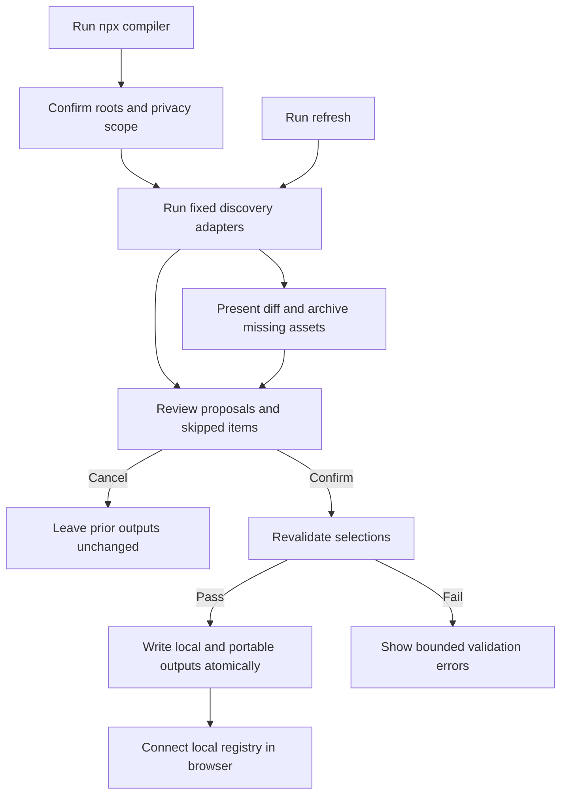

# Design: Local Registry Compiler

> Requirements: @requirements.md
> Status: Approved

## 1. Summary

The compiler is a Windows-first, user-scoped Node package invoked through `npx`. It reads only explicitly selected local metadata sources through fixed discovery adapters, projects each source into a bounded proposal model, merges logical duplicates with source provenance, and serves a one-time review page over an ephemeral loopback HTTP server. After explicit confirmation, it writes an exact-path local registry and a separate sanitized portable export.

The compiler remains separate from SancusSight's evidence collector. It never launches or calls upstream tools, never exposes a generic command endpoint, and never sends discovered data to a hosted service.

## 2. Requirements Mapping

| Requirement | Design Coverage |
|-------------|-----------------|
| FR-001 | Sections 3, 4, 7: explicit source selection and adapter allowlists |
| FR-002 | Sections 3, 6, 7: metadata projections and privacy firewall |
| FR-003 | Sections 3, 4: fixed adapters for projects, skills/plugins, commands, loops, workflows, MCPs, posts, configs, controls, evaluations, contracts, and adapters |
| FR-004 | Sections 5, 8: loopback review server and explicit confirmation transaction |
| FR-005 | Sections 3, 6, 9: skipped-item diagnostics and fail-closed handling |
| FR-006 | Section 6: conservative sensitivity classification |
| FR-007 | Section 4: stable logical identity and per-source/platform provenance |
| FR-008 | Section 6: exact local and sanitized portable serializers |
| FR-009 | Section 4, 8: refresh diff and archive/missing state |
| FR-010 | Sections 6, 10: schema, privacy, consistency, and diagnostic validation |
| FR-011 | Sections 3, 7: read-only process boundary and no upstream authority |
| FR-012 | Sections 3, 11: Windows-first npm packaging and `npx` entry point |
| FR-013 | Section 3: platform-neutral adapter contract with Windows defaults first |
| FR-014 | Section 11: deferred automation mode, not part of MVP |
| NFR-001 | Section 6: explicit field construction and portable path sanitization |
| NFR-002 | Sections 3, 4, 9: bounded scope, confidence, provenance, and skipped reports |
| NFR-003 | Section 5: grouped review with recommended selections |
| NFR-004 | Section 8: atomic writes, backups, and non-destructive refresh |
| NFR-005 | Section 5, 10: keyboard, reduced motion, status text, and browser checks |

## 3. Technical Approach

### 3.1 Package boundary

Add an operator-side compiler package in the SancusSight repository with a public executable entry point:

```text
npx sancussight-registry compile
npx sancussight-registry refresh
npx sancussight-registry validate <path>
```

The package has no dependency on the running collector and no network client. It may share the canonical `Registry` types, normalization rules, JSON Schema, and privacy constants from SancusSight, but it owns discovery and review orchestration.

### 3.2 Discovery adapter contract

Each adapter receives a bounded `DiscoveryContext` containing the selected roots, platform label, run ID, clock, and an allowlisted read-only filesystem interface. It returns a `DiscoveryResult`:

```text
DiscoveryResult
  inspected: SourceObservation[]
  proposals: AssetProposal[]
  skipped: SkippedItem[]
  diagnostics: Diagnostic[]
```

The first Windows adapter set is:

- Canonical project registry: project name, alias, lifecycle, canonical path alias, repository/deployment pointers, and registered artifact pointers.
- Skills/plugins: manifest name, provider, version, source path alias, and supported capability metadata.
- Agent configuration: fixed allowlisted provider/config identifiers and enabled capability names; never auth values, prompts, responses, or arbitrary settings.
- MCP inventory: server name, transport class, configured capability label, and source reference; never command arguments, environment values, headers, tokens, or tool payloads.
- Commands, loops, and workflows: registered identifier, human label, owner/source reference, lifecycle, and platform association; never command body, arguments, output, or executable invocation.
- Posts and publishing workflows: title/identifier, lifecycle/status, platform, source reference, and timestamps from approved metadata/front matter; never post body or draft content.
- Controls, evaluations, evidence contracts, and adapters: bounded manifest metadata and source references from known project inventories.

Adapters do not recursively scan arbitrary workspace content. The CLI first displays its default roots and requires the user to confirm or adjust them.

### 3.3 Read-only filesystem interface

The compiler uses a narrow interface with operations equivalent to `listDirectory`, `readMetadata`, and `readAllowlistedManifest`. It rejects paths outside confirmed roots, follows no symlink or junction outside the selected root, bounds file size and entry count, and never exposes a generic path or command parameter through the browser review API.

## 4. Proposal, identity, and merge model

### 4.1 Proposal model

`AssetProposal` is separate from the final `Asset` type and carries:

- stable proposal ID;
- proposed name, kind, format, platform, sensitivity, and confidence;
- bounded local path reference and portable alias;
- source adapter, source record identifier, observed timestamp, and source version;
- proposed provider dependencies, coverage, and evidence labels;
- skip reason or warning when the proposal is not selectable.

The browser consumes proposals, not raw source records.

### 4.2 Logical identity

The merge key is a canonical tuple of normalized asset kind, provider-neutral name, and declared stable identifier when available. Path-only identities are never used as the sole identity. If two proposals collide without sufficient confidence, the compiler keeps them as separate review candidates and explains the collision rather than silently merging them.

The final asset retains:

- one logical ID;
- merged platform coverage;
- bounded `evidenceBindings`/provenance references;
- source observations and latest observed timestamp in compiler sidecar metadata;
- a deterministic merge explanation for review and refresh diffs.

### 4.3 Refresh state

The compiler stores a small local sidecar beside the exact registry containing compiler version, run ID, source fingerprints, proposal identities, and archive state. The sidecar is not imported as user asset content. Refresh compares the new proposal set with the prior sidecar and registry, then presents additions, modifications, duplicates, and missing items. Missing items become `archived`/`missing` review records and are not removed automatically.

## 5. Review server and browser flow

1. The CLI validates prerequisites and prints the proposed roots and privacy boundary.
2. The CLI runs adapters and writes an ephemeral review bundle to memory or a bounded temporary directory.
3. The CLI starts a loopback-only HTTP server on an available local port with a one-time review token.
4. The browser opens the review URL. The page groups proposals by source and asset kind, preselects high-confidence non-sensitive proposals, and exposes search, filtering, skipped-item details, merge explanations, and root scope.
5. The user confirms or changes selections. The browser submits only proposal IDs, field overrides, and review decisions—not source content.
6. The CLI revalidates the selected IDs and overrides against the still-open review bundle and privacy validator.
7. The CLI atomically writes the local registry, portable export, compiler sidecar, skipped report, and a bounded summary.
8. The browser reports output paths, counts, skipped categories, and the SancusSight Connect-file next step. The server exits after completion or a bounded idle timeout.

The review page reuses SancusSight visual conventions and accessibility patterns but is packaged with the compiler so `npx` does not require a running SancusSight instance. Mutation routes require the one-time token and same-origin checks; no external origin is accepted.

## 6. Data and output contracts

### 6.1 Local registry

The exact local file is a normal `Registry` with `schemaVersion: 2`, exact local paths, `provenance.mode: "local"`, source timestamps, and only confirmed assets. The default Windows location is user-scoped application data, with an explicit `--local-out` override. The compiler creates a timestamped backup before replacing an existing file.

### 6.2 Portable export

The portable file has the same normalized registry shape but replaces user/home and machine-specific paths with bounded aliases such as `project:<stable-id>` and `root:<confirmed-root-id>`. It contains no exact local paths, user names, credentials, private keys, raw content, or skipped-item sensitive values. The default output is outside the project root; `--portable-out` is explicit.

### 6.3 Diagnostics

The skipped report contains only source type, bounded identifier, category (`ambiguous`, `sensitive`, `unsupported`, `unreadable`, `out-of-scope`), and safe remediation guidance. It never echoes the rejected value or file content. A run summary records inspected roots, adapter versions, proposal counts, selected counts, skipped counts, and output hashes.

### 6.4 Atomicity and recovery

Writes go to sibling temporary files, are validated, then replaced using an atomic rename. Existing local registry, portable export, and sidecar are retained until replacement succeeds. A failed adapter or write leaves prior outputs untouched and reports the affected source only.

## 7. Security, permissions, and privacy

- Discovery is explicitly read-only and user-scoped.
- The compiler never executes discovered commands or opens subprocesses for upstream tools.
- The CLI does not accept arbitrary executable strings, argument tails, or MCP calls.
- Path authorization is root-based and junction/symlink-aware.
- Manifest parsing uses explicit allowlists and bounded sizes; unknown fields are ignored or cause a skipped item according to source policy.
- Sensitive keys and values are rejected before proposal construction. Prohibited keys include prompt, response, reasoning, body, content, args, arguments, tool payloads, token, secret, credential, private key, and environment values.
- Exact paths are retained only in the local output and never sent to the browser's external network because the review server is loopback-only.
- Portable serialization is an explicit field projection, not a recursive deny-list sanitizer.

## 8. User flows and state transitions



## 9. Edge Cases

| Case | Expected Behavior |
|------|-------------------|
| Root does not exist | Mark root unreadable, continue unrelated adapters, and leave prior outputs intact. |
| Permission denied | Show bounded permission guidance; never retry with elevation or bypass. |
| Symlink/junction escapes root | Skip the entry and report out-of-scope. |
| Malformed manifest | Skip only that source record and report expected metadata shape. |
| Sensitive field detected | Exclude the proposal and report `sensitive` without echoing the value. |
| Duplicate across providers | Merge when identity confidence is sufficient; otherwise show a collision decision. |
| Same asset renamed | Use stable ID when present; otherwise show a reviewable change, never silently merge by path. |
| Existing output is locked | Preserve it, write no replacement, and provide recovery guidance. |
| User cancels review | Delete only the bounded temporary review bundle; retain existing outputs. |
| Partial adapter failure | Keep successful proposals and isolate the failed source in diagnostics. |
| No proposals survive privacy checks | Produce a valid empty report plus skipped diagnostics; do not fabricate assets. |

## 10. Accessibility and verification

The review page follows existing SancusSight conventions: semantic groups, text labels beside status colors, keyboard navigation, visible focus, reduced-motion support, responsive grouping at mobile widths, and no horizontal overflow.

Verification layers:

- Unit tests for each adapter's allowlist and bounded projection.
- Property tests for stable identity, duplicate merge, path aliasing, and idempotent refresh.
- Privacy tests that inject prohibited keys and confirm they never appear in proposals, outputs, diagnostics, or logs.
- Integration tests using temporary Windows directories for root authorization, junction escape, malformed sources, permission failure, atomic replacement, and archive refresh.
- Schema and output tests against the existing registry normalization/import path.
- CLI packaging smoke test using `npm pack --dry-run` and a temporary `npx`-style invocation.
- Browser checks for grouped review, cancel/confirm, skipped-item disclosure, keyboard focus, reduced motion, mobile layout, loopback-only network behavior, and console errors.

Preferred test seam: adapter input -> `DiscoveryResult` -> proposal merge/privacy validator -> serialized output. The first red/green test should prove that a fixture containing a prompt, command arguments, token, and tool payload is wholly excluded while its safe metadata sibling remains discoverable.

## 11. Observability and operations

Each run has a non-secret bounded run ID and writes a summary containing adapter IDs/versions, inspected root aliases, counts, skipped categories, output hashes, and duration. It does not write raw source records or sensitive diagnostics. Exit codes distinguish successful confirmed output, user cancellation, validation failure, and partial discovery with no output replacement.

The package README documents Windows prerequisites, default roots, explicit root confirmation, privacy limitations, output locations, recovery, `compile`, `refresh`, and `validate` commands. macOS/Linux adapter defaults remain a later extension of the same interface.

## 12. Migration and rollout

The compiler consumes existing schema-version-2 registries without mutation. An existing manually authored registry can be selected as the refresh baseline. The first release is opt-in and local-only; it does not change the collector, deployed browser behavior, or existing Spec 005 release evidence.

Rollout sequence:

1. Implement one end-to-end Windows compiler slice for the project registry and one agent inventory.
2. Add the remaining fixed adapters and privacy projections.
3. Add grouped browser review and portable serializer.
4. Add refresh/archive and recovery tests.
5. Package and browser-verify the `npx` flow.

Rollback is deleting or moving only newly generated compiler outputs; prior registries and SancusSight application data remain untouched.

## 13. Technical Decisions

### TD-001: Separate compiler process from collector

- **Decision:** Keep discovery and review in a standalone operator-side package.
- **Why:** The collector is read-only evidence ingestion and must not gain filesystem discovery or execution authority.
- **Trade-off:** Some registry types and UI conventions need a shared package boundary rather than direct collector reuse.
- **Alternatives considered:** Add discovery routes to the collector (rejected: expands authority and attack surface); browser-only manual selection (rejected: misses the requested complete known-inventory compilation).

### TD-002: Proposal model before normalized Registry

- **Decision:** Adapters emit bounded proposals, and only confirmed proposals become `Registry` assets.
- **Why:** Review, confidence, skipped reasons, and merge explanations do not fit safely in the final asset model.
- **Trade-off:** Requires an intermediate contract and a second validation pass.
- **Alternatives considered:** Write directly into `Registry` (rejected: obscures uncertainty and makes rollback harder).

### TD-003: Loopback review server with one-time token

- **Decision:** The CLI serves the review page locally and exits after confirmation or timeout.
- **Why:** It gives users a browser-grade review without hosted data transfer or a running collector dependency.
- **Trade-off:** Requires a small local HTTP server and packaged static assets.
- **Alternatives considered:** Terminal-only review (rejected: poor large-inventory UX); hosted review page (rejected: violates local-first privacy boundary).

### TD-004: Explicit serializer projections

- **Decision:** Build local, portable, and diagnostics outputs from explicit allowlisted fields.
- **Why:** Recursive sanitization is too easy to bypass with future source fields.
- **Trade-off:** New safe metadata fields require deliberate contract updates.
- **Alternatives considered:** Copy source manifests then redact (rejected: raw-content leakage risk).

### TD-005: Stable identity plus reviewable collision handling

- **Decision:** Merge only by stable/provider-neutral identity and surface uncertain collisions.
- **Why:** Path and display-name matching alone can conflate unrelated assets.
- **Trade-off:** Some duplicates require user review instead of automatic cleanup.
- **Alternatives considered:** Path-only identity (rejected: non-portable); provider-specific identity (rejected: hides portability relationships).

## 14. Risks

| Risk | Impact | Mitigation |
|------|--------|------------|
| Default roots differ across user installations | High | Show roots before discovery, require confirmation, report skipped/unreadable sources. |
| Metadata fields contain unexpected sensitive values | High | Explicit field construction, prohibited-key tests, portable revalidation, fail-closed skips. |
| Duplicate identity merges unrelated assets | Medium | Stable IDs first, confidence threshold, collision review, deterministic merge explanation. |
| Large inventories overwhelm review | Medium | Grouping, filtering, recommended selections, bounded counts, incremental refresh. |
| Windows filesystem links escape scope | High | Root authorization, junction/symlink checks, skip and report. |
| Npm package is mistaken for an execution agent | Medium | Read-only documentation, no subprocess authority, no generic command API, clear CLI copy. |

## 15. Implementation FAQ

**Q:** Does the compiler need Claude or Pi installed to inspect their metadata?  
**A:** No. It reads supported local metadata paths when present; absent providers appear as inspected-but-unavailable or skipped, not fabricated.

**Q:** Can it understand post content to classify a post?  
**A:** No. It may use explicitly allowlisted filename/front-matter metadata, but never stores the body.

**Q:** Can the browser review expose exact paths?  
**A:** The local loopback review may show bounded local references needed for confirmation, but portable output and diagnostics use aliases and never echo sensitive path values.

**Q:** Can users automate it in CI?  
**A:** Not in the first release. The interactive review is the required trust gate; automation is a later Could Have.

**Q:** Does refresh delete old assets?  
**A:** No. It archives and flags missing items, then requires confirmation for the resulting diff.
