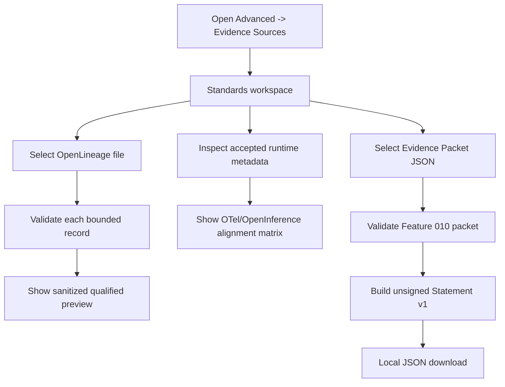

# Design: Standards Interoperability

> Requirements: `@requirements.md`
> Status: Approved
> Approval: Operator blanket approval for Feature 011 normal SDD progression,
> reconciled 2026-07-24 after requirements mapping, privacy, architecture, and
> no-dependency review

## 1. Summary

Feature 011 adds four native, dependency-free seams:

1. a bounded OpenLineage RunEvent file parser and sanitized projector;
2. a metadata-only OpenTelemetry/OpenInference alignment projector;
3. an unsigned in-toto Statement v1 builder over a validated Feature 010
   Evidence Packet; and
4. a browser-local preview store and one advanced Evidence Sources workspace.

External input is never used as a SancusSight asset, check result, governance
event, or verified lineage edge. Each adapter returns a qualified preview with
profile identity, accepted/rejected/omitted counts, safe hashes, and stable
reason codes.

## 2. Requirements Mapping

| Requirement | Design Coverage |
|---|---|
| FR-001 | Profile registry and exact-shape validators |
| FR-002 | OpenLineage parser/projector and byte/record bounds |
| FR-003 | Per-line isolation and stable result summary |
| FR-004 | Telemetry alignment projector over accepted runtime evidence |
| FR-005 | Statement v1 builder, validator, canonical download |
| FR-006 | Advanced Evidence Sources main workspace |
| FR-007 | Dedicated IndexedDB repository and memory fallback |
| FR-008 | Research note only; no runtime policy module |
| NFR-001 | Fixed allowlists, domain-separated hashes, prohibited-key checks |
| NFR-002 | Profile/stability labels and explicit non-claims |
| NFR-003 | Canonical serialization, ordering, caps, retention |
| NFR-004 | Local pure modules and isolated failures |
| NFR-005 | Native controls, focus entry/return, responsive single DOM |

## 3. Technical Approach

### 3.1 Profile registry

`src/lib/standards-profiles.ts` defines immutable profile descriptors:

- `openlineage-run-event-core-1.0.5`;
- `otel-genai-metadata-preview-1`;
- `openinference-metadata-preview-1`; and
- `sancussight-in-toto-statement-1`.

Each descriptor includes SancusSight projection version, upstream standard
name, upstream version/profile, stability, exact source URL, accepted input
kind, and limitation text. Profiles are data, not dynamic plugins.

### 3.2 OpenLineage import

`src/lib/openlineage-import.ts` accepts `{ text, byteLength, importedAt }` and
an injected async SHA-256 function.

Processing order:

1. reject more than 1 MiB before parsing;
2. split JSONL by line, or treat a JSON object/array as bounded records;
3. cap at 500 non-empty records;
4. parse and validate each record independently;
5. accept only the pinned RunEvent core shape and official pinned schema URL;
6. validate canonical timestamp, event type, run/job/input/output containers,
   and identifier bounds;
7. reject unknown top-level keys and non-object core entities;
8. omit all facets with stable counts/codes;
9. hash producer/schema/run/job/dataset identities in memory with distinct
   domain separators; and
10. return only the sanitized preview.

The preview contains no raw external string. It keeps profile ID, import time,
event-type counts, accepted/rejected/omitted counts, bounded reason-code
counts, and sorted safe hashes. Rejected lines are never echoed.

### 3.3 Telemetry alignment

`src/lib/telemetry-alignment.ts` consumes already accepted
`EvidenceEnvelopeV1` records whose source is `runtime-telemetry`. It never
parses raw OTLP.

The fixed matrix maps only allowlisted envelope attributes:

- runtime/provider/transport -> compatible resource/provider categories;
- event type -> `gen_ai.operation.name` candidate when the value is a bounded
  known metadata token;
- tool name -> operation-kind candidate without tool arguments/results;
- outcome/duration/approval -> SancusSight-only qualification rows; and
- source/event references -> safe hashes only.

Rows use `aligned`, `omitted-private`, `unsupported`, `missing`, or
`not-applicable`. The projector always adds explicit rows for prohibited
content families so the absence is understandable. It does not create spans,
trace IDs, parent links, resource objects, or OTLP payloads.

### 3.4 Unsigned Statement v1

`src/lib/in-toto-statement.ts` accepts a candidate Evidence Packet, injected
SHA-256, and export time.

It first calls the canonical Feature 010 packet validator. The exact output is:

```ts
interface SancusSightStatementV1 {
  _type: 'https://in-toto.io/Statement/v1'
  subject: [{
    name: 'sancussight-evidence-packet'
    digest: { sha256: string }
  }]
  predicateType:
    'https://sancussight.vercel.app/spec/evidence-packet-interoperability/v1'
  predicate: {
    schemaVersion: 1
    packetType: 'sancussight-evidence-packet'
    packetDigest: string
    subjectKind: string
    qualification: string
    verificationCount: number
    missingEvidenceCount: number
    unsigned: true
    externallyVerified: false
  }
}
```

The packet digest is the validated packet ID without the `sha256:` prefix.
Canonical JSON is recursively key-sorted. The builder validates the output
again, computes a local confirmation digest for UI status/filename, and
downloads the exact Statement JSON. The confirmation digest is not inserted
into the Statement.

`public/spec/evidence-packet-interoperability-v1.schema.json` publishes the
custom predicate contract at the canonical predicate URL after deployment.
It is a SancusSight contract, not an in-toto-maintainer endorsement.

### 3.5 Preview storage

`src/lib/interoperability-store.ts` owns a separate IndexedDB database:

```text
database: sancussight-standards-interoperability-v1
store: previews
key: auto-increment number
```

Stored records contain only:

- profile ID;
- operation kind;
- created time;
- accepted/rejected/omitted counts;
- stable reason-code counts;
- safe hashes;
- persistence state; and
- optional Statement confirmation digest.

The repository retains 20 per profile and 100 globally. Equivalent consecutive
previews deduplicate. Reads revalidate exact shapes. Failure returns
`unavailable` without rejecting the current in-memory result. Clear affects
only this database.

### 3.6 UI integration

`src/components/StandardsInteroperability.tsx` is rendered in the main content
area whenever the existing `evidenceSourcesActive` state is true. The existing
Evidence Sources rail remains adjacent and unchanged.

The workspace contains:

- profile/version/stability summary;
- OpenLineage file input and latest import summary;
- telemetry alignment table from accepted runtime evidence;
- Evidence Packet JSON file input and unsigned Statement export;
- local preview-history summary and Clear action; and
- a permanent limitations section.

No new navigation item is added. Opening Advanced -> Evidence Sources focuses
the workspace heading. Closing or choosing another destination restores useful
focus through existing navigation behavior. Narrow screens use the same
conditional main workspace and rail order; no duplicate interactive DOM is
created.

## 4. Component / Module Structure

```text
Feature 011
  src/lib/standards-profiles.ts
  src/lib/openlineage-import.ts
  src/lib/telemetry-alignment.ts
  src/lib/in-toto-statement.ts
  src/lib/interoperability-store.ts
  src/components/StandardsInteroperability.tsx
  public/spec/evidence-packet-interoperability-v1.schema.json
  src/App.tsx
  src/index.css
```

## 5. Data Model / State

Types live in `src/types.ts`:

- `InteroperabilityProfileV1`;
- `OpenLineagePreviewV1`;
- `AlignmentRowV1` and `TelemetryAlignmentPreviewV1`;
- `SancusSightStatementV1`;
- `InteroperabilityPreviewSnapshotV1`; and
- explicit available/unavailable operation result unions.

The component owns current in-memory results. IndexedDB is historical
convenience only and never becomes the source for Feature 009/010 truth.

## 6. API / Integration Contract

No network API is added. Browser inputs are local files. Browser outputs are
local Blob downloads. Hosted mode does not call localhost. Local mode reuses
accepted collector evidence already present in App state.

## 7. Security / Permissions / Privacy

- Check `File.size` before `File.text()`, then independently verify encoded
  byte length in the pure parser.
- External identifiers are hashed with domain-separated preimages and are
  never returned or stored.
- Unknown keys, profiles, schemas, predicate types, and unsafe values fail
  closed.
- OpenLineage facets are omitted wholesale; their values are never traversed,
  copied, stringified into output, or logged.
- OpenInference content attributes are represented only by fixed
  `omitted-private` rows.
- Statement export depends on successful Feature 010 packet validation.
- Errors use stable codes/guidance and never echo rejected content.

## 8. User Flows



## 9. Edge Cases

| Case | Expected Behavior |
|---|---|
| Oversized file | Reject before reading text where possible |
| Malformed JSON line | Count stable rejection; echo no content |
| Supported record plus unknown facet | Accept core projection; count facet omission |
| Unknown schema/profile | Unsupported; no projection |
| No runtime evidence | Alignment matrix shows missing/not-applicable |
| Content-like telemetry field | Omitted-private or upstream rejection; never projected |
| Invalid/tampered packet | No Statement or download |
| IndexedDB unavailable | Current preview usable; persistence unavailable |
| Web Crypto unavailable | Hash/export operation fails honestly |
| Download unavailable | Statement remains validated in memory; no export claim |

## 10. Accessibility / UX Notes

- Use native file inputs/buttons/details/tables.
- Status text accompanies every icon/color.
- Announce operation results through a polite status region.
- Focus the result heading after import/export; Clear returns focus to the
  workspace heading.
- Wrap hashes and profile URLs with `overflow-wrap:anywhere`.
- At 320 CSS pixels and effective 200%, controls stack and tables use bounded
  internal scrolling without page-level overflow.

## 11. Observability / Operations

No analytics, logs, remote telemetry, or runtime function is added. Browser
tests inspect console and network. Deployment verification confirms the public
predicate schema and static bundle bytes.

## 12. Migration / Rollout

No registry migration. Feature 011 storage is an independent optional database.
Removing the feature or clearing its store leaves all registry, evidence,
governance, check-history, and version-history state intact.

## 13. Technical Decisions

### TD-001: Native profiles, not standards SDK dependencies

- **Decision:** Implement the pinned bounded shapes in native TypeScript.
- **Why:** The supported subset is small and privacy-specific.
- **Trade-off:** Future profile changes require explicit code/spec updates.
- **Alternative:** Full SDKs; rejected because they expand runtime and accepted
  data surface.

### TD-002: OpenLineage preview is not a governance projection

- **Decision:** Keep imported observations in Feature 011 preview storage.
- **Why:** External lineage metadata is not automatically verified
  SancusSight evidence.
- **Trade-off:** Users cannot bind it into claims in this feature.
- **Alternative:** Emit governance/evidence events; rejected as an overclaim.

### TD-003: Align from accepted runtime evidence

- **Decision:** Do not reparse OTLP in the browser.
- **Why:** The collector already owns content rejection and metadata
  normalization.
- **Trade-off:** Hosted/manual mode needs an imported sanitized evidence
  snapshot to show alignment.
- **Alternative:** Generic browser OTLP import; rejected on privacy/scope.

### TD-004: Statement without envelope

- **Decision:** Export exact Statement v1 plus custom predicate only.
- **Why:** Authentication choices are intentionally unresolved.
- **Trade-off:** Consumers receive structure and digest binding, not signer
  identity.
- **Alternative:** DSSE/signing; deferred.

### TD-005: Dedicated preview store

- **Decision:** Separate IndexedDB database and retention.
- **Why:** Clear/failure isolation must not touch Feature 009/010 history.
- **Trade-off:** One additional small browser store.
- **Alternative:** Reuse check history or registry storage; rejected due to
  truth and lifecycle coupling.

## 14. Risks

| Risk | Impact | Mitigation |
|---|---|---|
| Compatibility copy overclaims certification | High | Exact profile/stability/non-claim labels and R1 review |
| External identifiers leak through hashes | Medium | Domain separation, no preimages, no raw display/storage |
| Evolving standards make mappings stale | Medium | Pinned profiles and explicit unsupported state |
| Evidence Sources becomes too dense | Medium | Main workspace with progressive sections, no new primary nav |
| Statement is mistaken for signed attestation | High | `unsigned: true`, no envelope fields, persistent warning |
| Dirty tree overlap | High | Serialized visible workers with exact owned surfaces |

## 15. Verification Strategy

- Unit: exact profile registry, OpenLineage isolation/privacy/bounds,
  alignment states, Statement shape/digest/privacy, store retention/failure.
- Static UI: one workspace, existing navigation ownership, copy/non-claims.
- Regression: Feature 008/009/010, collector, compiler, core, build.
- Browser: real local Chromium import, alignment, Statement download,
  IndexedDB allowlist, clear isolation, focus, 320px, effective 200%, console,
  and same-origin/loopback-only traffic.
- Hosted: exact reviewed artifact, public predicate schema, Statement
  download, no third-party/localhost request, console/runtime.
- Preferred first red seam: malicious OpenLineage facets and raw identifiers
  cannot enter the projected result.

## 16. Implementation FAQ

**Q: Does a supported OpenLineage record become verified evidence?**  
A: No. It is an external metadata observation with a pinned profile and
explicit qualification.

**Q: Does an aligned row mean standards compliance?**  
A: No. It means one accepted SancusSight metadata field has a compatible
meaning in the named preview profile.

**Q: Is the Statement an attestation?**  
A: It is an unsigned in-toto Statement-shaped document. There is no envelope,
signer, or external verification.

**Q: Why publish a custom predicate schema?**  
A: It gives consumers a stable exact shape and canonical URI without implying
that in-toto maintainers registered or endorsed it.

## Design Visualization Offer

```yaml
visualization_offer:
  stage: design
  source_revision: feature011-design-20260724-01
  recommended: no
  recommendation_reason: The module boundaries, privacy transformations, and one UI flow are explicit; HTML would not resolve a human decision.
  state: declined
  adapter: visualize-sdd
  mode: design-explainer
  ui_image_offer: not-applicable
  decision_source: Operator standing no-HTML preference under autonomous progression.
```
