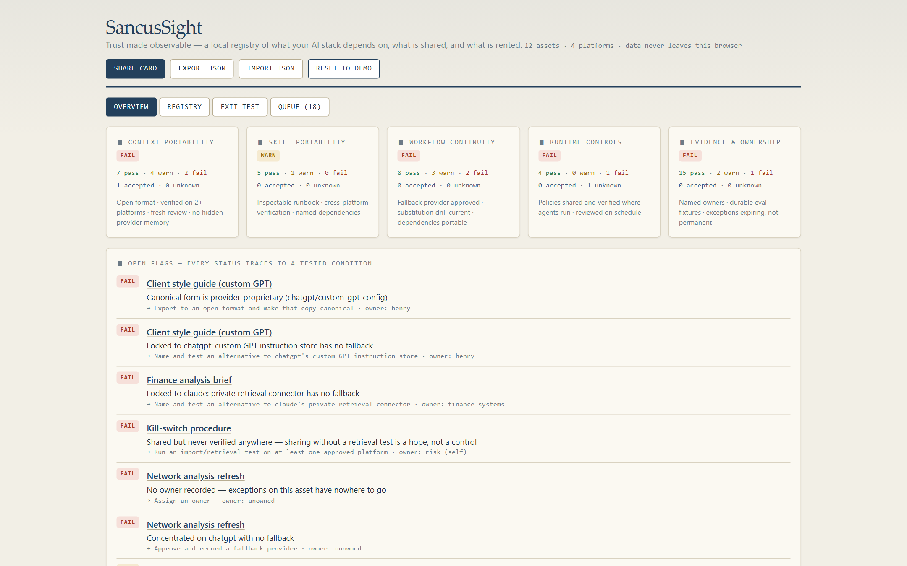

# SancusSight

A local-first registry of everything your AI stack depends on — context, skills, workflows, evaluations — that shows you what breaks if a provider disappears tomorrow.

[](LICENSE)



## Features

- **Registry** — inventory AI assets as metadata only; prompts, context bodies, and credentials never enter the tool
- **Coverage matrix** — assets × platforms, showing where each asset is shared, verified, stale, or absent
- **Deterministic checks** — explicit conditions, same registry in, same signals out; no model calls
- **Exit test** — pick a workflow and a target platform, get survives / degrades / breaks, item by item
- **Remediation queue** — everything that needs a human, worst first, with named owners and expiring accepted risks
- **Share card** — a privacy-safe aggregate you can post without publishing your stack inventory

Every signal shows the condition tested, the finding, the evidence, the owner, and the required action — no single opaque score.

## Quick start

```bash
npm install
npm run dev      # http://localhost:5175
npm test
```

Data lives in your browser's `localStorage` only. Export/import the registry as JSON to version it in git — which is itself the point. Deploys as a standard Vite static app (a synthetic demo registry ships with it).

## Scope

Passing an exit test proves the *conditions* of portability — formats, coverage, verification, fallbacks — not equivalent model behavior on the target platform. It is not a compliance opinion. The registry itself is a sensitive inventory; it stays local by design.

## Architecture

`src/domain/` is framework-free (types, checks, exit test, storage) with its own tests; `src/components/` imports only from domain. The checks can run headless — e.g., as a CI step over a committed `registry.json`.

*Named for Sancus, the Roman god of trust and oaths: sight over the conditions of trust, not a certification of it.*

## License

[MIT](LICENSE)
